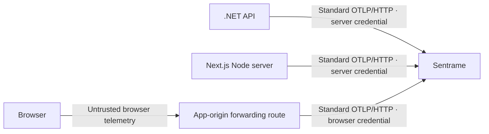

# Send OpenTelemetry to Sentrame from .NET and Next.js

**Your Next.js server does not need to send its telemetry through your .NET API.** Each server can use its own standard OpenTelemetry SDK/exporter and send directly to Sentrame. A shared OpenTelemetry Collector is an optional operational hop when you need centralized routing or buffering; your business API does not need to become a telemetry collector.



This guide contains **source-checked configuration and example code**, with separately scoped runtime-qualified disposable samples listed below. A passed sample does not qualify every snippet, application or deployment route. Sentrame's current qualification covers the origin OTLP/HTTP combinations recorded in [local review](LOCAL-REVIEW.md), standard wire fixtures and the synthetic demonstrations. Actual SDK versions, browser behavior and the deployed HTTPS/tunnel route require their own checks. The [2026-10-30–31 WFS integration lessons](#9-lessons-from-the-wfs-integration) below add actual local Node and .NET application evidence; earlier disposable samples remain separately identified.

## 1. Know which process is sending

| Where the event happened | What to configure | Credential |
| --- | --- | --- |
| .NET API/backend | .NET OpenTelemetry logging/tracing exporters | Server producer token, kept server-side |
| Next.js Route Handler, Server Action or rendering on Node | Next.js `instrumentation.ts` plus one Node OpenTelemetry provider | Server producer token, kept server-side |
| Browser click, screen entry, tab visibility or browser exception | Browser SDK plus an intentionally designed same-origin forwarding route | Sentrame browser producer token on the forwarding leg |
| Another viewer browsing Sentrame | Owner passphrase or temporary viewer invite | Viewer access; never use this for telemetry |

The receiver assigns `browser` or `server` authority from the configured producer credential. A `service.name`, an attribute saying “server”, or forwarding a browser record through a server cannot make the browser's claim authoritative. Use the **browser** credential when forwarding browser records. A browser saying “Vote clicked” differs from a trusted API saying “Vote persisted”.

A Next.js server is a server process. Configuring it does **not** collect browser clicks or client-component errors. A Collector also must preserve browser/server authority through separate authenticated pipelines; combining everything under the server token would lose that distinction.

## 2. Endpoint and authentication

Use your deployed Sentrame origin, for example `https://sentrame.your-domain.example`. For local development on the **same Mac**, use `http://127.0.0.1:8096`. `localhost` inside another container refers to that container; use a deliberately configured reachable address instead. The NAS package and tunnel boundary are described in [NAS.md](NAS.md).

| Signal | Full OTLP/HTTP endpoint |
| --- | --- |
| Logs, named events, custom error messages | `https://sentrame.your-domain.example/v1/logs` |
| Spans and span exceptions | `https://sentrame.your-domain.example/v1/traces` |
| Metrics receipt | `https://sentrame.your-domain.example/v1/metrics` |

For Protobuf use `Content-Type: application/x-protobuf`; OTLP JSON uses `application/json`, not an arbitrary application JSON envelope. The signal and envelope must agree: log records use `/v1/logs`, spans with their span events use `/v1/traces`. Do not post an `ILogger`/named-log envelope to the traces endpoint. HTTP Protobuf is not gRPC, and reception support does not qualify a proxy, compression option or deployed route.

Send `Authorization: Bearer <producer-token>`. Do not put tokens in URLs or use the owner's viewer passphrase as an ingestion credential. Metrics are currently receipt-only; they do not create individual journey steps or supported application-metric arithmetic.

### Obtain generated connection settings

Sign into Sentrame as the owner, register/select the named app and open **App settings**. Reveal/copy the appropriate generated browser/server Authorization header. Sentrame stores credentials in private JSON, never SQLite; do not generate tokens manually or put producer tokens into Sentrame's deployment environment. This is greenfield setup with no legacy import. [App workspaces and recovery](MULTI-APP.md).

Configure each sender's existing exporter or secret store with these values. Keep the server credential server-only; the browser forwarder uses the browser role. No Sentrame SDK, app-ID attribute or instrumentation rewrite is required. The custom variable names in the examples below belong to the **external sender's configuration**, not the Sentrame server. Reuse existing .NET and Next.js providers. A shared Collector must separate each app/role into credential-bound exports.

Rotate roles explicitly in App settings and update affected senders afterward. Restart and app registration do not rotate existing credentials. Owner passphrases and viewer invitations are separate.

### Configure the exporter

For SDKs configured through standard environment variables:

```dotenv
OTEL_EXPORTER_OTLP_ENDPOINT=https://sentrame.your-domain.example
OTEL_EXPORTER_OTLP_PROTOCOL=http/protobuf
OTEL_EXPORTER_OTLP_HEADERS=Authorization=Bearer%20REPLACE_WITH_SERVER_PRODUCER_TOKEN
OTEL_SERVICE_NAME=your-api
OTEL_RESOURCE_ATTRIBUTES=service.version=1.0.0
```

The **common** HTTP endpoint is a base URL: standard exporters append the signal path. Signal-specific variables such as `OTEL_EXPORTER_OTLP_LOGS_ENDPOINT` instead take the **complete** `/v1/logs` URL. Explicit exporter URL options also need the complete signal URL; the examples below set those explicitly. `%20` encodes the space in the environment-header value. Keep real values in your deployment's secret configuration, not committed files or chat. [OTLP exporter configuration](https://opentelemetry.io/docs/specs/otel/protocol/exporter/) defines the endpoint/header behavior; the [.NET exporter guide](https://opentelemetry.io/docs/languages/dotnet/exporters/) shows the explicit `HttpProtobuf` options.

For the programmatic examples below, set these server-only application settings instead:

```dotenv
SENTRAME_OTLP_BASE=https://sentrame.your-domain.example
SENTRAME_SERVER_TOKEN=REPLACE_WITH_SERVER_PRODUCER_TOKEN
OTEL_SERVICE_NAME=your-api
SERVICE_VERSION=1.0.0
```

Those `SENTRAME_*` names are convenient configuration for the example application, **not required telemetry attributes or a proprietary SDK**. The code turns them into ordinary OTLP exporter options. Do not add a `NEXT_PUBLIC_` prefix to server credentials. Next.js documents that prefix as browser-exposed configuration. [Next.js environment-variable guidance](https://nextjs.org/docs/app/guides/environment-variables).

### Send your app version

Send the release/build version of the application being instrumented as the **OTel resource attribute `service.version`**. Sentrame reads this resource attribute into its version field. Set it on the resource shared by your logs and traces; adding it only to an individual log or span's attributes does not populate that field. This is your application's version, not the Sentrame server version or the OpenTelemetry SDK version.

Choose a stable value identifying the deployed code, such as `1.4.2` or a Git commit SHA, and supply it from your CI/CD release metadata when building or deploying the sender. Keep the value unchanged for that build; do not generate a new version per request or process start.

Use the configuration path that matches your sender:

| Sender setup | How to send the version |
| --- | --- |
| SDK using standard environment configuration | Set `OTEL_RESOURCE_ATTRIBUTES=service.version=1.4.2`. If you already set other resource attributes, append `,service.version=1.4.2` to that list. |
| .NET example below | Set `SERVICE_VERSION=1.4.2`; the example passes it to `AddService(service, serviceVersion: version)` for both tracing and logging resources. |
| Next.js Node example below | Set `SERVICE_VERSION=1.4.2`; the example explicitly sets `'service.version'` on its SDK resource. |
| Browser SDK | Set `'service.version'` on the browser SDK resource using a public build-time release value. Server environment settings do not automatically configure browser telemetry. |

`SERVICE_VERSION` is a variable read by these examples, not a standard OTel environment variable. In particular, the Next.js example disables resource auto-detection and reads this value explicitly, so configure `SERVICE_VERSION` when following that example. Both programmatic examples fall back to the literal `unknown` when it is missing; set a real value to distinguish releases.

For frontend/backend components released together, use the same app release value and distinct `service.name` values. If components release independently, use each component's actual version; do not label different builds as the same release just to make their telemetry match. App selection and producer authority still come from the ingestion credential, not `service.version`.

## 3. .NET: collect logs, exceptions and request traces

These illustrative snippets target ASP.NET Core with OpenTelemetry .NET **1.20.1**. They collect broad application logging and use ambient SDK configuration; they do not implement WFS's minimized, private export policy. For the separately qualified OTel **1.20.0** composition and its timeout limits, use [the WFS .NET recipe](#qualified-wfs-net-composition--2026-10-31). Install compatible packages in the application you intend to instrument; these commands have not been executed against WFS:

```sh
dotnet add package OpenTelemetry.Extensions.Hosting --version 1.20.1
dotnet add package OpenTelemetry.Exporter.OpenTelemetryProtocol --version 1.20.1
dotnet add package OpenTelemetry.Instrumentation.AspNetCore --version 1.20.1
dotnet add package OpenTelemetry.Instrumentation.Http --version 1.20.1
```

The core packages are listed in the official [1.20.1 release](https://github.com/open-telemetry/opentelemetry-dotnet/releases/tag/core-1.20.1); [ASP.NET Core](https://www.nuget.org/packages/OpenTelemetry.Instrumentation.AspNetCore/1.20.1) and [HTTP instrumentation](https://www.nuget.org/packages/OpenTelemetry.Instrumentation.Http/1.20.1) have matching published versions. In an existing app, reconcile its package graph and lock files instead of registering a second OpenTelemetry provider. If it uses Serilog, NLog or another logging pipeline, verify the bridge for that pipeline; direct calls to a different logging API are not automatically captured by the `ILogger` setup shown here.

A small `Program.cs` integration:

```csharp
using System.Diagnostics;
using OpenTelemetry.Exporter;
using OpenTelemetry.Logs;
using OpenTelemetry.Resources;
using OpenTelemetry.Trace;

var builder = WebApplication.CreateBuilder(args);
var baseUrl = builder.Configuration["SENTRAME_OTLP_BASE"]
    ?? throw new InvalidOperationException("Set SENTRAME_OTLP_BASE");
var token = builder.Configuration["SENTRAME_SERVER_TOKEN"]
    ?? throw new InvalidOperationException("Set SENTRAME_SERVER_TOKEN");
var service = builder.Configuration["OTEL_SERVICE_NAME"] ?? "demo-api";
var version = builder.Configuration["SERVICE_VERSION"] ?? "unknown";

void ExportTo(OtlpExporterOptions options, string signal)
{
    options.Endpoint = new Uri(baseUrl.TrimEnd('/') + "/v1/" + signal);
    options.Protocol = OtlpExportProtocol.HttpProtobuf;
    options.Headers = "Authorization=Bearer " + token;
}

builder.Services.AddOpenTelemetry()
    .ConfigureResource(r => r.AddService(service, serviceVersion: version))
    .WithTracing(traces => traces
        .AddAspNetCoreInstrumentation()
        .AddHttpClientInstrumentation()
        .AddOtlpExporter(options => ExportTo(options, "traces")));

builder.Logging.AddOpenTelemetry(logs =>
{
    logs.IncludeScopes = true;
    logs.IncludeFormattedMessage = true;
    logs.SetResourceBuilder(ResourceBuilder.CreateDefault()
        .AddService(service, serviceVersion: version));
    logs.AddOtlpExporter(options => ExportTo(options, "logs"));
});

var app = builder.Build();

// A controlled local development check. Do not add an unauthenticated
// telemetry-trigger endpoint to a deployed business application.
if (app.Environment.IsDevelopment())
{
    app.MapPost("/internal/telemetry-demo/error", (ILogger<Program> logger) =>
    {
        try
        {
            throw new InvalidOperationException("Vote persistence unavailable; retry permitted");
        }
        catch (InvalidOperationException error)
        {
            Activity.Current?.SetStatus(ActivityStatusCode.Error,
                "Vote persistence unavailable; retry permitted");
            logger.LogError(new EventId(0, "vote.persistence.failed"), error,
                "Controlled telemetry check failed");
            return Results.StatusCode(503);
        }
    });
}

app.MapGet("/", () => "Application running");
app.Run();
```

The explicit .NET `Headers` option above uses a literal space after `Bearer`; its pinned parser accepts that value and also decodes URL-encoded environment-header values. [Exact 1.20.1 header parser](https://github.com/open-telemetry/opentelemetry-dotnet/blob/core-1.20.1/src/OpenTelemetry.Exporter.OpenTelemetryProtocol/OtlpExporterOptionsExtensions.cs). The Next.js example uses a plain JavaScript headers object with the same literal space.

Run the development app and call its own `/internal/telemetry-demo/error` endpoint once. After the SDK's batch export, open **Sentrame → Errors** and look for `vote.persistence.failed`, the configured service and a scrubbed exception message/stack. This tests logging; HTTP instrumentation supplies related technical spans. A server error can remain discoverable without a visit ID. Let the ASP.NET Core host shut down gracefully so its registered providers can flush queued telemetry.

The exporter serializes `ILogger` exceptions into standard exception fields and uses the named `EventId` as the OTLP event name. In the pinned exporter, the numeric logging-template ID is separately named `logrecord.event.id` when its experimental emission is enabled; it is not an occurrence identity. The sample's numeric zero avoids relying on that optional field. **Ordinary `ILogger` reception does not need a custom `event.id`.** [Pinned .NET log serializer](https://github.com/open-telemetry/opentelemetry-dotnet/blob/core-1.20.1/src/OpenTelemetry.Exporter.OpenTelemetryProtocol/Implementation/Serializer/ProtobufOtlpLogSerializer.cs), [pinned experimental option names](https://github.com/open-telemetry/opentelemetry-dotnet/blob/core-1.20.1/src/OpenTelemetry.Exporter.OpenTelemetryProtocol/Implementation/ExperimentalOptions.cs).

For a real business milestone, emit a named log **after** its actual operation succeeds:

```csharp
// In the trusted service, after the real persistence operation has completed:
logger.LogInformation(new EventId(0, "vote.committed"), "Vote persisted");
```

The name is discoverable even though ordinary informational bodies are not retained as diagnostic text. Use controlled event names; do not put recipe names, customer input, URLs or IDs into the name. This use of .NET structured logging follows the [OpenTelemetry ASP.NET Core logging model](https://opentelemetry.io/docs/languages/dotnet/logs/getting-started-aspnetcore/).

To illustrate optional **server-only operation** correlation across several named events:

```csharp
var operationVisit = Guid.NewGuid().ToString("N");
using (logger.BeginScope(new Dictionary<string, object?>
{
    ["session.id"] = operationVisit
}))
{
    logger.LogInformation(new EventId(0, "demo.operation.started"),
        "Synthetic operation started");
    // Run the actual operation here in your application.
    logger.LogInformation(new EventId(0, "demo.operation.completed"),
        "Synthetic operation completed");
}
```

The scope is a random operation value, not a logged-in user or household ID. This illustration does not perform or prove a real operation; in application code the completed event belongs after actual success. `IncludeScopes=true` exports the structured scope. Mapping the two names and choosing the completed event as goal can then produce a journey. Without correlation the valid records still remain received/discovered, with dependent journey interpretation unavailable.

## 4. Next.js: initialize one Node provider for traces and logs

This example uses the manual Node SDK path, **not `@vercel/otel` at the same time**. Next.js documents conditional Node-only initialization in `instrumentation.ts`; the Node SDK is not an Edge SDK. Existing `@vercel/otel`, monitoring-agent or OpenTelemetry setup must be reconciled before adding this provider. [Next.js instrumentation setup](https://nextjs.org/docs/app/guides/open-telemetry).

The example deliberately uses a coherent published OpenTelemetry JS **3.0.0 / 0.300.0** family and Node **22.15.0 or newer**:

```sh
npm install --save-exact @opentelemetry/api@1.10.0 \
  @opentelemetry/sdk-node@0.300.0 \
  @opentelemetry/sdk-logs@3.0.0 \
  @opentelemetry/resources@3.0.0 \
  @opentelemetry/exporter-logs-otlp-proto@0.300.0 \
  @opentelemetry/exporter-trace-otlp-proto@0.300.0
```

In this family the log API is exported from `@opentelemetry/api`, and `BatchLogRecordProcessor` takes an options object containing `exporter`. Do not mix this code with older `@opentelemetry/api-logs`/0.2xx examples. Check compatibility with your existing Next.js dependencies before upgrading them. [JS 3.0 release and migration](https://github.com/open-telemetry/opentelemetry-js/releases/tag/v3.0.0), [Node SDK dependency versions](https://github.com/open-telemetry/opentelemetry-js/blob/v3.0.0/experimental/packages/opentelemetry-sdk-node/package.json), [log processor constructor](https://github.com/open-telemetry/opentelemetry-js/blob/v3.0.0/packages/sdk-logs/src/export/BatchLogRecordProcessorBase.ts).

Place `instrumentation.ts` at the project root, or under `src` alongside `app` when the app uses `src`:

```ts
// instrumentation.ts
import type { Instrumentation } from 'next';

export async function register() {
  if (process.env.NEXT_RUNTIME === 'nodejs') {
    await import('./instrumentation.node');
  }
}

export const onRequestError: Instrumentation.onRequestError = async (error) => {
  if (process.env.NEXT_RUNTIME === 'nodejs') {
    const telemetry = await import('./instrumentation.node');
    await telemetry.reportServerError(error);
  }
};
```

`onRequestError` catches errors observed by the Next.js server, not browser exceptions. The hook's error may have been processed by React; it does not guarantee an original source stack. Do not serialize its request headers, cookies, URL query or request body. [Next.js `onRequestError` contract](https://nextjs.org/docs/app/api-reference/file-conventions/instrumentation).

```ts
// instrumentation.node.ts — server-only; never import from a Client Component.
import { context, logs, SeverityNumber } from '@opentelemetry/api';
import { NodeSDK } from '@opentelemetry/sdk-node';
import { BatchLogRecordProcessor } from '@opentelemetry/sdk-logs';
import { defaultResource, resourceFromAttributes } from '@opentelemetry/resources';
import { OTLPLogExporter } from '@opentelemetry/exporter-logs-otlp-proto';
import { OTLPTraceExporter } from '@opentelemetry/exporter-trace-otlp-proto';

const base = process.env.SENTRAME_OTLP_BASE;
const token = process.env.SENTRAME_SERVER_TOKEN;
if (!base || !token) throw new Error('Set server-side Sentrame exporter settings');
const headers = { Authorization: `Bearer ${token}` };
const endpoint = (signal: string) => `${base.replace(/\/$/, '')}/v1/${signal}`;

export const logProcessor = new BatchLogRecordProcessor({
  exporter: new OTLPLogExporter({ url: endpoint('logs'), headers }),
  scheduledDelayMillis: 1000,
});
const sdk = new NodeSDK({
  autoDetectResources: false,
  resource: defaultResource().merge(resourceFromAttributes({
    'service.name': process.env.OTEL_SERVICE_NAME ?? 'demo-next-server',
    'service.version': process.env.SERVICE_VERSION ?? 'unknown',
  })),
  traceExporter: new OTLPTraceExporter({ url: endpoint('traces'), headers }),
  logRecordProcessors: [logProcessor],
  metricReaders: [],
});
sdk.start();

export function reportBusinessEvent(name: string, attributes: Record<string, string> = {}) {
  logs.getLogger('app.journeys').emit({
    eventName: name,
    severityNumber: SeverityNumber.INFO,
    body: 'Application milestone',
    attributes,
    context: context.active(),
  });
}

export async function reportServerError(caught: unknown) {
  const error = caught instanceof Error ? caught : new Error('Non-Error value thrown');
  logs.getLogger('app.errors').emit({
    eventName: 'app.server.error',
    severityNumber: SeverityNumber.ERROR,
    body: 'Server operation failed',
    attributes: {
      'exception.type': error.name,
      'exception.message': error.message,
      'exception.stacktrace': error.stack ?? '',
    },
    context: context.active(),
  });
  // Await the hook's export work. Do not flush on every normal business event.
  await logProcessor.forceFlush();
}

// Call this from the application's existing orderly shutdown path. Do not
// install competing process.exit/SIGTERM handlers that bypass Next shutdown.
export const shutdownTelemetry = () => sdk.shutdown();
```

The provider is initialized once per Node server instance, before requests. Its exporters use **HTTP Protobuf** and explicit full paths. `reportBusinessEvent('vote.committed')` in a server operation produces a standard named log; call it only where that server operation actually happens. `reportServerError(new Error('Controlled synthetic failure'))` is a simple controlled development check. The API's `eventName`, standard exception attributes and current active context are defined by the [pinned JS log record API](https://github.com/open-telemetry/opentelemetry-js/blob/v3.0.0/api/src/logs/LogRecord.ts); the [Node SDK registration implementation](https://github.com/open-telemetry/opentelemetry-js/blob/v3.0.0/experimental/packages/opentelemetry-sdk-node/src/sdk.ts) establishes its providers.

This does not make `console.error` automatically become an OTLP log. Bridge the application's logging library intentionally or call a small controlled adapter such as the functions above. Batch export can be lost on abrupt/serverless termination; integrate the host's supported flush/shutdown lifecycle. Do not run this Node provider in Edge or a Client Component.

### Optional label enrichment in existing emitters

**Source-checked additions, actual exporters separately qualified.** First explore ordinary request/persistence spans and map a trusted `vote.committed` fact to **Vote saved** without custom attributes. Add an optional label only to reduce configuration entry. Reuse the application's current provider and active operation; these additions require no SDK replacement, extra provider or wrapper.

For .NET, add to the relevant existing Activity or the existing named post-commit log:

```csharp
using System.Diagnostics;
using System.Collections.Generic;
using Microsoft.Extensions.Logging;

// Only if this existing span actually represents persistence:
Activity.Current?.SetTag("stage.name", "voting.persist");
// Alternative: within the existing post-commit emitter; IncludeScopes=true:
using (logger.BeginScope(new Dictionary<string, object?>
{
    ["stage.name"] = "voting.persist"
}))
{
    logger.LogInformation(new EventId(0, "vote.committed"), "Vote persisted");
}
```

For the pinned Next.js Node/OTel API family, enrich the existing span or named log:

```ts
import { context, logs, trace, SeverityNumber } from '@opentelemetry/api';

// Only on the existing persistence operation:
trace.getActiveSpan()?.setAttribute('stage.name', 'voting.persist');
// Alternative: in the existing trusted post-commit emitter:
logs.getLogger('app.journeys').emit({
  eventName: 'vote.committed',
  severityNumber: SeverityNumber.INFO,
  context: context.active(),
  attributes: { 'stage.name': 'voting.persist' },
});
```

Emit each business fact through one intentional carrier; the alternatives above are not a request to duplicate it. Use stable lowercase dot-separated values (`voting`, `voting.submit`, `voting.persist`); avoid IDs, content, routes and start/end suffixes. Preview offers a suggestion, while an explicit owner **Vote saved** mapping wins over emitted `voting`. Missing hints leave name-based mapping useful; distinct labels require review. Acceptance creates a literal prospective rule and does not rename prior captures or imply Kind, goal, authority, session or timing boundaries. See [precedence](integration/OTEL-CONTRACT.md#optional-stagename-suggestions).

## 5. Connect traces across Next.js and .NET

A trace/span ID answers “which technical operation is related?” It is different from an app visit, an action occurrence and a viewer login. HTTP instrumentation can propagate standard W3C `traceparent`/`tracestate`; it does not invent a business visit.

For a known trusted outbound API destination, Next.js can explicitly inject the active context into that request:

```ts
import { context, propagation } from '@opentelemetry/api';

const carrier: Record<string, string> = {};
propagation.inject(context.active(), carrier);
const response = await fetch(process.env.APP_API_ORIGIN + '/your-fixed-route', {
  headers: carrier,
});
```

Use a configured trusted destination, not a user-controlled URL, and add the application's normal authentication independently. Do not inject the Sentrame producer token into this business request. The .NET incoming instrumentation can continue that trace. This is technical propagation; an application must separately choose and explicitly carry permitted random business correlation when joining browser intent and server commitment. Do not put personal identity into baggage or infer a join from close timestamps. [OpenTelemetry context propagation](https://opentelemetry.io/docs/concepts/context-propagation/).

## 6. Add journey context only when you need it

The fields and mapping Kinds below are Sentrame-supported application interpretation, not a universal OpenTelemetry journey schema. Standard logs/spans work without them.

For concrete minimum envelopes and the distinction between .NET Activities, events and Sentrame activity/presence records, read the [OTel event/activity contract](integration/OTEL-CONTRACT.md). It also explains optional `stage.name`, native inclusive operation timing and explicit paired stage alternatives.

Sentrame accepts ordinary valid standard telemetry **without** event IDs, session IDs, a custom schema or Sentrame fields. A useful exception can appear in Errors without any journey. A mapped event with insufficient journey context remains received/unassigned rather than fabricating a path. With an **empty captured definition**, named non-diagnostic browser logs with explicit safe `session.id` and `tab.id` can already form a goal-free navigation path. That path uses retained `stage.name` or the event name, with positive unique `source.sequence` ordering where available. It does not manufacture a completion goal, conversion, stage duration or trust in a server outcome. Explicit event-to-stage mappings, including their exclusions, take precedence; they may also intentionally have no completion goal. Native span trees reconstruct technical parent relationships independently and do not become browser navigation paths. See [the current contract](integration/OTEL-CONTRACT.md#minimums-depend-on-the-question).

| Optional field | What it supports | What to avoid |
| --- | --- | --- |
| Resource `service.name`, `service.version` | Distinguish API/Next services and releases | Using these self-asserted values as authorization |
| Record `session.id` | A random visit or bounded server operation | User, household, email, device or persistent analytics identity |
| Record `tab.id` | Keep browser tabs separate | One browser scope reused across tabs |
| Record `event.id` | A string identifying one emitted record, stable for exact retry | Static logging-template ID, regenerating on retry, or reusing one ID for different events |
| Record `source.sequence` | A positive, unique increasing integer within one source/service and anonymous browser scope/tab, for retained navigation order | Counting receipt order as source order, reusing sequence numbers or putting a person ID here |
| Record `action.id` | Random action linkage across related evidence | Treating it as a record ID or a person's identity |
| Record `stage.occurrence.id` | Pair one real stage start/end occurrence | Reusing it for repeated visits to the same stage |
| `stage.name`, `stage.state`, `activity.state`, `reason` | Safe bounded mapping/timing/exit meaning | Customer text, arbitrary payload objects or sensitive labels |
| Standard trace/span IDs | Technical causal context where propagation is verified | Treating a trace as an anonymous visit or viewer credential |

These are the fields currently projected by [the receiver](../internal/app/intake.go), not a requirement for basic OTLP reception. A producer SDK normally supplies timestamps; custom wire fixtures must use fresh occurrence times. A record's identity is separate from timestamp ordering and from the occurrence identity used to pair timing.

For browser journeys, generate a fresh random scope/tab in that tab's in-memory telemetry state after the application's collection/privacy decision. Rotate it when that anonymous visit ends; do not persist a tracking identity or join a later visit. For example, `const visit = crypto.randomUUID(); const tab = crypto.randomUUID();` inside a tab-local telemetry module. This is an instrumentation design choice, not a consent implementation. Sending the same safe random values to the backend for correlation must be an explicit application change with validated scope and retained browser/server authority.

An automatically recorded `GET /recipes` span is useful technical evidence. It is **not** automatically “Viewed recipe”, “Saved vote” or “Agreement reached”. Emit controlled semantic events at those actual milestones and map them in the workspace.

## 7. First useful integration, one observation at a time

1. Verify receipt using ordinary spans/logs through the intended authenticated route. Inspect service, carrier, name and safe fields; metrics remain receipt-only. For an empty-definition browser navigation question, first inspect the existing correlated goal-free path before adding mappings. For a business outcome, configure explicit meaning and a separately justified goal.
2. Open **Traces** for native operation timing, parents, events, log context and links. A request needs no stage/session/occurrence attributes. Errors stay useful without a journey.
3. On an operation or named event choose **Give business meaning**. Select exact service, trusted producer, carrier and name; optionally use one retained condition. Enter Stage/Kind and preview. Existing native span identity supplies an operation occurrence and inclusive duration, without paired logs or a custom ID. Point-event duration remains unavailable unless an explicit supported alternative is chosen.
4. Activate prospectively. The default overlay retains receipt-time definitions; **Non-persisting preview** explicitly tries another version. Choose an exact goal mapping. A span goal evaluates at its valid completion/end; an event goal at its event time. A failed or missing-end span does not establish completed goal evidence.
5. For voting, `GET /vote` is request work, a browser press is intent, and `POST /votes` plus child `vote.persist` spans show processing/repetition. A trusted `vote.committed` observation after actual commit can establish **Vote saved**. HTTP2xx and browser intent cannot prove persistence. A publication error after commit preserves the commitment and records separate friction; retry/recovery and completion-screen observation remain distinct.
6. Add optional label hints only to reduce configuration entry; add random scope/tab only for a path across requests. Add actual page boundaries/presence only for the unanswered page-time question. No IP, user-agent, time-proximity or cross-visit inference joins observations.
7. Qualify the actual .NET/Next.js exporter separately, including batching, propagation and shutdown through durable protected reads. Wire fixtures and source snippets do not establish SDK or deployed-route support.

Conditions use only retained fields: `reason`, `stage.name`, `stage.state`, `activity.state`, exception type/occurrence, bounded SDK/runtime/environment metadata, HTTP method, minimized route template and integer response status. For `http.route=/votes/{voteId}`, enter Condition key `http.route` and Equals `/votes/{voteId}`. Unknown fields are unavailable, never recovered from raw OTLP. Conflicting explicit rules block activation; disjoint service/carrier/source/condition selectors can coexist. See the [producer contract](integration/OTEL-CONTRACT.md) and [actual local evidence](verification/standard-otel.md).

### A manual standard wire check

This creates a **local payload file only**. Replace the destination and provide the server producer token in your shell's secret environment before deliberately running `curl`. It contains no journey-specific fields, so the expected result is a discovered accepted-unassigned error.

```sh
export SENTRAME_OTLP_BASE=http://127.0.0.1:8096
# Set SENTRAME_SERVER_TOKEN locally; do not paste a real token into this document.
python3 - <<'PY'
import json, time
from pathlib import Path
payload = {"resourceLogs": [{
    "resource": {"attributes": [
        {"key": "service.name", "value": {"stringValue": "manual-wire-check"}}
    ]},
    "scopeLogs": [{"logRecords": [{
        "timeUnixNano": str(time.time_ns()),
        "eventName": "demo.standard.error",
        "severityNumber": 17,
        "body": {"stringValue": "Controlled synthetic error for receiver setup"}
    }]}]
}]}
Path('/tmp/sentrame-wire-check.json').write_text(json.dumps(payload))
PY
curl --fail-with-body --silent --show-error \
  -H "Authorization: Bearer ${SENTRAME_SERVER_TOKEN:?Set the server producer token}" \
  -H 'Content-Type: application/json' \
  --data-binary @/tmp/sentrame-wire-check.json \
  --write-out '\nHTTP %{http_code}\n' \
  "${SENTRAME_OTLP_BASE%/}/v1/logs"
```

Expect HTTP200 with an OTLP response. An HTML login page or HTTP redirect from an access proxy is not successful receiver acceptance. This sends standard OTLP/HTTP **JSON**, not Protobuf binary. A successful wire check does not qualify a language SDK or prove a journey. The version-controlled [REST requests](../rest/) and fixture Taskfile commands provide richer repeatable Protobuf demonstrations, replay identities and read-path checks.

## 8. Privacy and debugging limits

Emit only controlled technical messages and necessary attributes. Default auto-instrumentation may include URLs or other context **before** Sentrame sees it; review sender-side minimization before real export, especially when a proxy/tunnel is on the path. Do not export request bodies, authorization/cookie headers, connection strings, tokens, SQL parameters, personal/business objects or customer text just because the receiver later filters fields.

Sentrame retains bounded scrubbed error bodies, exception messages and stacks under its current policy. Scrubbing is imperfect. INFO bodies and unknown attributes are generally omitted; source maps are not applied, stack/source lines are as emitted, and missing/sampled diagnostics do not prove absence of errors. Error severity does not automatically end a journey. Supported detail expires after 30 days; supported summaries retain 12 months and do not preserve expired individual stacks.

Browser forwarding is deliberately left as a reviewed integration boundary, not a generic unauthenticated JSON upload route in this guide. Use standard OTLP from the browser, validate/bound same-origin forwarding, preserve the browser producer namespace, and verify CSP/CORS/lifecycle behavior. Do not convert browser events into trusted server statements. The viewer passphrase, invite link and viewer cookies must never enter application telemetry.

## Qualification record

Source review on 2026-10-28 checked the current receiver field projection, .NET 1.20.1 package/exporter behavior, Next.js Node-only initialization/error hooks and the coherent JS 3.0.0/0.300.0 API family. The main snippets remain illustrative/source-checked. A separate disposable .NET sample has been compiled and run as recorded below; Next.js Node qualification is also recorded independently below. Actual SDK receipt, automatic propagation, browser forwarding, exporter shutdown behavior and the NAS/tunnel route remain checks to perform against the chosen application's locked versions. A source-checked recipe is useful setup guidance, not a passed compatibility cell.


## Purposeful richer voting context

For one path across navigation, press, failed request, retry, commit, publication error/recovery and completion-screen observation, explicitly propagate a fresh random bounded `session.id` and browser `tab.id` onto participating records. OTel's client session convention is opt-in and Development; Sentrame also interprets that key for server workflows. SDKs do not automatically copy this scope or arbitrary baggage into logs/spans. Review propagation only across approved application boundaries. Native W3C trace context remains technical execution context; neither it nor IP/user-agent/time proximity joins visits. Do not emit `session.previous_id` or a persistent person/device identity. Server-only scopes need no invented browser tab.

For page elapsed time use a real encompassing native page interval, or explicit same-occurrence page entry/exit if no such span exists. For observed-active time require actual visibility/idle observations under the disclosed60-second refresh cap. Never emit positive heartbeats while hidden/idle or infer them from HTTP duration/clicks. Native server operation latency, paired page elapsed and observed-active distributions stay separate; no overlap sum claims unique user time or attention.

Captured journeys keep their definition through goal/inactivity closure. A native goal evaluates at a usable end; a late earlier prefix within the inactivity gap associates with the retained capture's definition while keeping its immutable receipt definition. New native records never mutate accepted span identities. Saved trace references pin trace mode and optional explicit definition preview, while journey references query chronological captured boundaries. Detail expires at30 days; links/references cannot resurrect it. Twelve-month aggregates retain no scope/trace IDs or diagnostic text and identify timing/computation policy.

The [progressive synthetic story](integration/synthetic-demo.md#scoped-voting-story) proves local wire behavior, including configured completion-screen evidence distinct from commitment. It does not prove actual browser collection or actual .NET/Next exporter behavior.


### Runtime-qualified .NET cell

On 2026-10-29 a disposable ASP.NET Core/.NET10.0.2 sample (SDK 10.0.102, exact OpenTelemetry 1.20.1 packages and lock file) passed direct Mac OTLP/HTTP Protobuf **uncompressed** logs/traces through actual receiver commit and protected reads, including graceful batch shutdown and receiver restart. It exercised real failed/saved/post-commit-error file operations, native parent/time, EventId names, exception messages/stacks, optional span/scope hints and exact log context with one provider per signal. [Exact evidence and source hashes](verification/standard-otel.md) limit the claim. Gzip/JSON/.NET11/metrics/cross-service/browser/Tunnel/Collector and deployments remain separate unrun cells; the guide's specific demo endpoint was not the qualified sample route.


### Runtime-qualified Next.js Node cell

A disposable Next 16.4.3 App Router sample on Node 26.12.0 with React 19.2.0 and exact OTel API 1.10.0 / SDK 3.0.0 / experimental 0.300.0 passed direct Mac OTLP/HTTP Protobuf **uncompressed** logs/traces. It verified one initialization, real route/persistence/error boundaries and `onRequestError`, native parent/time, named commitment/error logs, optional hints, exact log context, explicit SDK flush/shutdown and actual receiver restart. [Exact source/lock hashes and limitations](verification/standard-otel.md) scope the claim. The main TypeScript snippets remain source-checked; this runtime sample used JavaScript. Gzip/JSON/Edge/browser/metrics/cross-service/Tunnel/Collector and deployment routes remain separate cells.

### Runtime-qualified isolated browser cell

Chrome 156.0.8078.49 Guest on macOS ARM64 exercised the disposable Next 16.4.3 app-origin forwarder using API 1.10.0, `@opentelemetry/sdk-trace`, logs/resources/core 3.0.0 and HTTP Protobuf exporters 0.300.0, compression none. Reuse the existing app SDK; this test sample required one browser provider per signal because none existed. Explicit opt-in, bounded Origin/content-type/stream checks, browser authority, token-free bundles, CSP/CORS, real browser→Node W3C parentage, failure/retry/commit, visibility/idle and controlled flush passed through durable protected reads. An unended span was lost on navigation as expected. The sample uses a 1.5-second idle threshold for qualification, not a recommended production threshold. Abrupt shutdown, mobile browsers, Edge, serverless delivery and production consent policy are not qualified. See [the exact evidence and source hashes](verification/standard-otel.md).


## 9. Lessons from the WFS integration

These lessons come from isolated synthetic local integration on 2026-10-30–31. WFS’s selected standard-OTel change is now **20/20 accepted, synced and archived**; that local completion does not qualify production collection or every deployment/device route. The [final qualification checkpoint](verification/standard-otel.md#wfs-completed-integration-checkpoint--2026-10-31) separates current browser/API/native evidence from earlier versioned proof. The Node and M3 checkpoints remain historical evidence for their exact identities.

| Area | Verified setup or lesson |
| --- | --- |
| Node compatibility | WFS Next **16.4.2** / React **19.3.1**, Node **26.12.0**, npm **11.21.1**; official OTel API **1.10.0**, trace/log/resource/context SDK packages **3.0.0**, HTTP Protobuf exporters **0.300.0**. This differs from the earlier disposable Next16.4.3 sample. Keep the app's lock file and one existing initialization path; do not mix an older logging API family or install a second provider. |
| HTTP field names | Next's native producer exposed legacy `http.method` and `http.status_code`. Those keys were dropped by Sentrame's projection even when HTTP200 intake and trace structure passed. The minimized producer projection now emits **`http.request.method`** and integer **`http.response.status_code`**. Use **`http.route`** only for an approved minimized template; do not fall back to URL/path/query. Verify values in protected reads, not just export status. |
| Authority and context | WFS browser logs use browser authority and `wfs-pwa-browser`; native Node spans use server authority and `wfs-pwa-server`. Fixed resource `service.name`/release `service.version` identify components, while credentials select the registered app and trust role. Browser logs explicitly use `ROOT_CONTEXT`; this WFS policy does **not** join ambient browser traces, remote trace/baggage, cross-service calls or browser/server timing. A separate disposable browser→Node propagation test does not change that policy. |
| Privacy before buffering | WFS projects allowed fixed resources, operation names and canonical fields **before** the batch queue. URL/path/query, content, span events/links, status text and host/process identity do not enter that queue. Export HTTP self-instrumentation is suppressed. Receiver filtering remains a second boundary, not permission to buffer secrets or arbitrary payloads upstream. Preserve native IDs/parent/times when minimizing allowed spans. With the pinned JS log SDK, retain approved attributes in place: deleting and re-adding them consumes the attribute-count budget again and can lose required `source.sequence`. Keep error-occurrence fields error-only. Use unmistakable private sentinels; short hexadecimal test values can collide with valid random UUIDs. |
| Sampling and counts | WFS Node native capture samples approved GET/HEAD read roots at10% and excludes remote-parent roots; it is not an HTTP request counter. Fifteen retained native spans/eight traces and seven original browser logs are exact fixture evidence, not traffic totals or evidence of complete delivery. A missing parent remains missing; attempted320 is not received320. Always record sampling, queue drops, omitted projections and unexported-work uncertainty separately. |
| Delivery bounds | WFS Node used queue256/batch64/delay1s, processor wait2s, exporter concurrency1 and Agent `maxSockets=1`/`maxTotalSockets=1` per exporter. These are finite per-pipeline settings, not a total process memory budget. In this Node stack, the caller/processor wait and socket inactivity timeout do **not** prove a hard end-to-end deadline: active requests or retry backoff can outlive the caller. Normal Next SIGTERM/SIGINT is best effort and can lose a tail; `beforeExit` is skipped by explicit exit. Do not add global HTTP patches, custom cancellation/transport or competing host signal handlers to claim stronger guarantees. |
| Replay | Preserve the same log `event.id` or native trace/span identity and retained content for exact retry. The canonical WFS batches were replayed and read after receiver reopen without count/field changes. New IDs mean new evidence; changing an accepted immutable native identity is a conflict, not an update. A receiver acknowledgement does not prove that every SDK attempt was sent. For replay/reopen comparisons, compare stable retained evidence and derived journeys; whole protected snapshots also contain changing health/clock metadata. Record source, fixture and receiver identities so a current retention result does not silently inherit an older reopen result. |
| Configuration and CI | Fail closed on invalid/missing enabled export configuration; preserve default-off/consent choices and existing business/log/metric pipelines. Validate endpoints, role separation, resource/version, bundle secrets, queue/timeout policy and supported package composition before runtime. Give every new browser test its explicit live receiver capability and owner; a helper that merely returns HTTP success must not silently replace durable receiver assertions. WFS native suites require private `WFS_NATIVE_RECEIVER_CREDENTIALS`. Its durable error fixture needs **both** `WFS_NAV_SENTRAME_BINARY` (the reviewed owned executable) and `WFS_ERROR_SENTRAME_ASSETS` (matching reviewed built `web/dist`), plus `WFS_ERROR_DURABLE=1`; binary-only configuration stops before observations/UI. Record binary and asset hashes together. These are WFS fixture settings, not Sentrame runtime requirements. |

### Presentation and outcome boundaries

**Qualify the receiver’s actual version and definition behavior.** WFS’s older pinned host binary rejected an optional no-goal definition even though the reviewed source supported it. The M4–M7 image/adapter identity is separately qualified in the ledger. Configure prospective mappings using exact service, authenticated source, carrier, event name and retained stage/reason selectors. Paths then derive from received sequences; do not seed journeys or infer goals. Presentation and issue-result fixtures intentionally have **no goal**. The earlier M2 synthetic Search goal belongs to that versioned fixture, not a production completion policy.

**Observe presentation at its semantic owner.** An intent to open a dialog, a mounted hidden branch or a shell does not prove the content was shown. WFS uses fixed surface declarations, actual native-dialog open state and instance-owned leases that aggregate zero-to-one/one-to-zero transitions without closing another instance. Leaving immediately revokes admission of new point observations. Loaded detail/image observations follow committed visible content and the current load; stale promise completion contributes nothing. An external launch records a request, including blocked launches; it cannot establish reading, return, attention, completion or persistence. The direct ImageReview composition fixture does not qualify its production entrypoint or a physical camera/share flow.

**Classify raw responses before generated normalization.** A generated client may coerce missing flags, enums, nullable fields or dates into plausible values before telemetry sees them. WFS’s per-call typed-node parse hook validates the raw Save contract, retains only a closed local result classification, and delegates the unchanged generated decoder and error mappings. Finite `Date.parse` is insufficient: `1`, a date-only string, February 30 and `24:00` can parse or normalize despite violating the required date-time/calendar contract. Validate those raw clocks before classification; never export inspected response content or business IDs. Only the current visible submission may produce one browser result; hide, close, replacement or supersession permanently invalidates it. Existing Kiota 503 retries can issue several HTTP attempts for one explicit Save; the fixture uses terminal 400 when it must count submissions independently of retry attempts.

Browser results distinguish manual-save acknowledgement, processing acknowledgement, saved-with-launch-failure and unconfirmed response. None proves repaired content or reimport completion. The trusted API producer independently proves facts after actual ordinary confirmed persistence/removal; service-observer mocks alone cannot establish export. Browser acknowledgements and API facts use separate credentials and no shared identity or timing join. See [the qualified .NET composition](#qualified-wfs-net-composition--2026-10-31) for the privacy boundary and [the final evidence ledger](verification/standard-otel.md#wfs-completed-integration-checkpoint--2026-10-31) for exact fixture scope.

### Qualified WFS .NET composition — 2026-10-31

The M3 WFS fixture qualified actual ASP.NET/HttpClient capture, saved facts, privacy, retry and protected retention/replay/reopen with official OTel **1.20.0** packages. WFS targets **net11.0** and pins SDK **11.0.100-rc.2.26504.105** / runtime **11.0.0-rc.2.26504.105** on Linux ARM64. The protected API/PostgreSQL fixture instead ran on macOS 26.7.2, SDK **11.0.100-rc.3.26522.148** / runtime **11.0.0-rc.3.26522.148**. The older disposable .NET10/OTel1.20.1 sample above remains a separate cell. These exact tested versions do not establish support for every .NET11 release or deployment.

**Setup in WFS:** reuse its installed package graph and existing `builder.Services.AddWfsTelemetry(builder.Configuration)` registration in `api/src/RecipeApi/Telemetry/WfsTelemetry.cs`. `AddWfsTelemetry` is WFS application wiring, not a Sentrame SDK to install; another app should compose the same supported APIs in its existing startup. The host owns one standard trace provider in place of the previous hosted `.WithTracing`; do not add a second provider/agent. Native ASP.NET and HttpClient instrumentation remain. A separate private `ServiceCollection` owns `ILoggerFactory`/`LoggerProvider` for the typed saved fact; the general application logger is not attached to this export. Operational Serilog logging and metrics retain their destinations. The supported Serilog suppression callback and native destination filters prevent exporter self-capture; a broad operational destination colliding with the selected receiver (including known loopback aliases) is refused at startup.

The API accepts only these four server-owned application settings; they are WFS names, not Sentrame deployment requirements:

```dotenv
WFS_TELEMETRY_ENABLED=true
SENTRAME_OTLP_BASE=https://sentrame.your-domain.example
SENTRAME_SERVER_TOKEN=REPLACE_WITH_SERVER_PRODUCER_TOKEN
WFS_VERSION=synthetic-api-1
```

The flag defaults off and enables only for exact `true`. Use an HTTPS origin, or explicit loopback HTTP, with no userinfo/path/query/fragment. The token must be nonempty printable ASCII without whitespace, comma or percent (the pinned SDK header parser treats those specially). Obtain it privately from the synthetic app's generated server connection settings; never forward a browser token into API configuration. Invalid or disabled selected configuration creates no selected exporter. Settings are an **immutable process-start snapshot**: recreate the API process/container after changes. Node's runtime export checks do not imply API hot-disable or batch-entry reconfiguration.

**SDK isolation:** the trace builder and private logging service collection each receive the same private `IConfiguration`, built with `AddInMemoryCollection` only. It selects `OTEL_DOTNET_EXPERIMENTAL_OTLP_RETRY=in_memory`; no environment providers are added. Endpoint, headers, protocol, compression, resource and bounds are explicit. This blocks ambient disk retry/resource/destination settings in the selected pipelines. Retry is an experimental SDK configuration input, not a public `OtlpExporterOptions` retry property. Direct `new OtlpTraceExporter(...)` can recreate ambient experimental options; named hosted options alone do not prove isolation. Use standard SDK registration, without environment mutation, reflection, a fork or custom retry. See the pinned [experimental configuration](https://github.com/open-telemetry/opentelemetry-dotnet/blob/core-1.20.0/src/OpenTelemetry.Exporter.OpenTelemetryProtocol/Implementation/ExperimentalOptions.cs) and [exporter options](https://github.com/open-telemetry/opentelemetry-dotnet/blob/core-1.20.0/src/OpenTelemetry.Exporter.OpenTelemetryProtocol/OtlpExporterOptions.cs).

This compile-checked excerpt shows the private configuration/resource seam used by WFS. It intentionally stops before exporter registration: the actual integration also supplies its reviewed privacy processor, sampler, explicit exporters and host disposal. It is not a complete copy/paste production provider:

```csharp
using Microsoft.Extensions.Configuration;
using Microsoft.Extensions.DependencyInjection;
using OpenTelemetry;
using OpenTelemetry.Logs;
using OpenTelemetry.Resources;
using OpenTelemetry.Trace;

var privateConfiguration = new ConfigurationBuilder()
    .AddInMemoryCollection(new Dictionary<string, string?>
    {
        ["OTEL_DOTNET_EXPERIMENTAL_OTLP_RETRY"] = "in_memory"
    }).Build(); // No AddEnvironmentVariables or automatic resource detectors.

ResourceBuilder Resource(string version) => ResourceBuilder.CreateEmpty()
    .AddService("RecipeApi", serviceVersion: version,
        autoGenerateServiceInstanceId: false)
    .AddTelemetrySdk();

var traces = Sdk.CreateTracerProviderBuilder()
    .ConfigureServices(services =>
        services.AddSingleton<IConfiguration>(privateConfiguration))
    .SetResourceBuilder(Resource("synthetic-api-1"));

var privateLogs = new ServiceCollection();
privateLogs.AddSingleton<IConfiguration>(privateConfiguration);
privateLogs.AddOpenTelemetry().WithLogging(logging =>
{
    logging.SetResourceBuilder(Resource("synthetic-api-1"));
}, options =>
{
    options.IncludeScopes = false;
    options.IncludeFormattedMessage = false;
});
```

Both explicit signal exporters use `/v1/traces` or `/v1/logs`, `HttpProtobuf`, compression `None`, the server Bearer header and `TimeoutMilliseconds=2000`. Their supported `HttpClientFactory` supplies `SocketsHttpHandler` with `AllowAutoRedirect=false`, `MaxConnectionsPerServer=1`, `UseProxy=false`, connect/drain waits of 2s and drain size 0; the client timeout is 2s and response buffer/SDK diagnostic response limit 1024 bytes. Each standard batch processor has **256 waiting records plus at most 64 active**, batch 64, delay 1000ms and exporter wait 2000ms. Logging needs its own `BatchExportProcessorOptions` in the log exporter overload; the trace exporter options do not configure the log queue. Typed saved/resolved facts share admission of at most 100/minute; native traces have independent capacity. Standard SDK serialization/retry owns delivery. Actual hostile ambient disk settings created no disk queue, lost-ack 503 retry preserved identical bytes and same-origin 307 reached no redirect target.

**Approved timeout limitation:** OTel1.20.0 exporter Error diagnostics can read an unsuccessful response body with no bytes for **over 3.2 seconds**, despite two-second exporter/client/processor settings and the 1 KiB response limit. `ForceFlush` can return `true` while that read is still active. These settings bound caller/processor waits; they do not establish a total network deadline, response-body inactivity bound, all-I/O termination or blocked-read shutdown cancellation. Healthy Linux Program SIGTERM exited 0 in a separate smoke test. That does not qualify shutdown while the diagnostic read is blocked. Normal .NET shutdown is also best effort with possible queued-tail loss. This .NET diagnostic-read limitation is separate from Node's active-request/backoff limit and Next's best-effort signal shutdown; no global diagnostics patch, competing signal handler or custom transport was added.

**Privacy and retained meaning:** a synchronous processor runs before standard batching. It keeps fixed `api.request`/`api.http` names, canonical `http.request.method` and integer `http.response.status_code`, native IDs/local parents/kind/times/status, and removes mutable raw tags, status descriptions, tracestate and baggage. It drops unknown source/kind, nonempty source version/tags/schema, immutable events/links and remote-root descendants by clearing `Recorded`; returning alone would still allow the next batch processor to enqueue. Standard parent-based 10% local-root sampling inherits local choices, with both sampled and unsampled remote parents off. WFS .NET does not emit `http.route`; the Node route policy is separate. This is sampled technical evidence, not a request count or browser journey.

The resource starts empty without detectors or generated `service.instance.id`: exactly `service.name`, `service.version`, `telemetry.sdk.name`, `telemetry.sdk.language`, `telemetry.sdk.version` (OTel 1.20.0; schema 1.44.0). Protected Sentrame reads retain service/version/language but intentionally omit SDK name/version from projected attributes; maintained OTLP decoding checks all five original resource fields separately. Native instrumentation scopes carry no private version/tags/schema.

The trusted persistence observer runs after an ordinary **confirmed save**, before later launch/read. It emits INFO 9, fixed body `WFS recipe issue saved`, fixed `event.name=wfs.recipe_issue.saved` and a fresh random UUID `event.id`. The pinned .NET exporter leaves OTLP's newer EventName field absent; Sentrame's retained `event.name` fallback is qualified. The private logger takes no scopes/exception and clears ambient `Activity.Current` synchronously for the call, restoring it in `finally`. The record has equal occurrence/observed server time and no trace/span/document/business context. Saved-before-launch/read failure remains a saved fact; rejected, uncertain and outer-transaction saves emit none. The saved event does not assert resolution or user completion, and it does not create a browser journey. The completed integration separately emits `wfs.recipe_issue.resolved` after an ordinary confirmed report removal; uncertain/outer transactions, no-op removal, active work and cascade paths emit no such fact. Resolution means report removal, not repaired content or completed reimport.

### Reproduce the owned WFS .NET fixture

In an authorized WFS checkout, use its pinned dependencies and an already reviewed installed local Sentrame image. Set `WFS_TEST_POSTGRES_CONNECTION` privately for an **owned disposable synthetic PostgreSQL admin database**, and set `WFS_API_SENTRAME_IMAGE` to that image's local identity. No real data or shared receiver should be used. From the WFS repository root:

```sh
# Set both variables privately; never print the database connection or tokens.
: "${WFS_TEST_POSTGRES_CONNECTION:?Set an owned synthetic PostgreSQL admin connection}"
: "${WFS_API_SENTRAME_IMAGE:?Set a reviewed installed local Sentrame image}"
task test:database -- --filter \
  'FullyQualifiedName~RecipeIssueTelemetryPostgresTests|FullyQualifiedName~RecipeIssueTelemetryPersistencePostgresTests|FullyQualifiedName~RecipeImportReportPostgresTests'
```

The fixture owns its fresh receiver/container/network/volume/database, memory-only ephemeral credentials, protected reads, exact replay/reopen and cleanup; it has no image-pull fallback. It does not use retained receiver18986 or preview19010. The M3 run of these three selected classes passed **18/18, zero skips**: 17 persistence/report cases and one actual exporter/receiver case. That M3 live case retained three distinct saved facts and nine sampled native spans, including a real HttpClient child/local ASP.NET parent; six forwarded log copies included one identical retry of the three-record batch. Independent SQL and protected retained fields were checked. The final API-source-compatible run is **29/29, zero skips**, with its own PostgreSQL 17.11 fixture and retained identity in [the final ledger](verification/standard-otel.md#wfs-completed-integration-checkpoint--2026-10-31); the M3 PostgreSQL 18.6 proof is not relabeled. Filtering only `RecipeIssueTelemetryPostgresTests` selects the single live case. Default PostgreSQL gates exclude `LiveReceiver_`; ordinary API tests may skip it. Missing live prerequisites block explicit acceptance, so an ordinary green/skipped run is not a substitute. The command is a maintained WFS example verified from its source and retained result; this Sentrame documentation update did not rerun it or create resources. WFS’s default macOS database runner uses the pinned Linux SDK without forwarding the image environment or Docker access: it qualifies relational suites, not this opt-in receiver case. An explicit live selection must produce an actual `LiveReceiver_` result; ordinary mocked CI or a skipped result cannot fill that cell. Freeze source during gates and record compile-cache mutations that invalidate a run’s identity even when tests passed.

The pinned Linux production Program smoke separately issued 185 requests (25 foreign-context controls), exported 16 native spans/16 traces in two batches and verified safe canonical fields and all five resource attributes; baseline Program exported none. **That is Linux wire proof; protected host RC3 retention is a separate result.** The [dated ledger](verification/standard-otel.md#wfs-net-m3-checkpoint--2026-10-31) records exact identities, full-gate evidence and remaining deployment gaps.

### Minimal runnable native Node check

Use a **new disposable local app**, its server producer token, and a loopback receiver. This standalone synthetic process initializes its own SDK because none exists; in an application, reuse the existing provider instead. It emits one native span and one named log with explicit technical context, no session/tab, no business commitment and no automatic journey. The actual check passed on Node26.12.0/npm11.20.0 using the exact versions below; this npm runtime differs from the WFS application setup above.

In a new scratch folder:

```sh
npm init -y
npm install --save-exact @opentelemetry/api@1.10.0 \
  @opentelemetry/sdk-node@0.300.0 @opentelemetry/sdk-trace@3.0.0 \
  @opentelemetry/sdk-logs@3.0.0 @opentelemetry/resources@3.0.0 \
  @opentelemetry/exporter-trace-otlp-proto@0.300.0 \
  @opentelemetry/exporter-logs-otlp-proto@0.300.0
# Set SENTRAME_OTLP_BASE and SENTRAME_SERVER_TOKEN privately from App settings.
node synthetic-node.mjs
```

Save this as `synthetic-node.mjs`:

```js
// Standalone synthetic process only. Reuse an existing provider in an application.
import { randomUUID } from 'node:crypto';
import { ROOT_CONTEXT, trace, logs, SeverityNumber } from '@opentelemetry/api';
import { NodeSDK } from '@opentelemetry/sdk-node';
import { AlwaysOnSampler, BatchSpanProcessor } from '@opentelemetry/sdk-trace';
import { BatchLogRecordProcessor } from '@opentelemetry/sdk-logs';
import { resourceFromAttributes } from '@opentelemetry/resources';
import { OTLPTraceExporter } from '@opentelemetry/exporter-trace-otlp-proto';
import { OTLPLogExporter } from '@opentelemetry/exporter-logs-otlp-proto';

const base = new URL(process.env.SENTRAME_OTLP_BASE ?? '');
if (base.protocol !== 'http:' || !['127.0.0.1', 'localhost', '[::1]'].includes(base.hostname)
    || base.username || base.password || base.pathname !== '/' || base.search || base.hash)
  throw new Error('Use a plain loopback HTTP origin for this synthetic example');
const token = process.env.SENTRAME_SERVER_TOKEN;
if (!token) throw new Error('Set the new synthetic app server producer token privately');
const exporter = (signal) => ({
  url: new URL('/v1/' + signal, base).href,
  headers: { Authorization: `Bearer ${token}` },
  compression: 'none', timeoutMillis: 2000, concurrencyLimit: 1,
  httpAgentOptions: { keepAlive: false, maxSockets: 1, maxTotalSockets: 1 },
});
const bounds = {
  maxQueueSize: 256, maxExportBatchSize: 64,
  scheduledDelayMillis: 1000, exportTimeoutMillis: 2000,
};
const sdk = new NodeSDK({
  autoDetectResources: false, instrumentations: [], textMapPropagator: null,
  resource: resourceFromAttributes({
    'service.name': 'sentrame-native-demo', 'service.version': 'synthetic-1',
  }),
  sampler: new AlwaysOnSampler(), // Small synthetic check, not a production policy.
  spanProcessors: [new BatchSpanProcessor({
    exporter: new OTLPTraceExporter(exporter('traces')), ...bounds,
  })],
  logRecordProcessors: [new BatchLogRecordProcessor({
    exporter: new OTLPLogExporter(exporter('logs')), ...bounds,
  })], metricReaders: [],
});
sdk.start();
const span = trace.getTracer('synthetic-check').startSpan('demo.operation', {}, ROOT_CONTEXT);
logs.getLogger('synthetic-check').emit({
  eventName: 'demo.operation.observed', severityNumber: SeverityNumber.INFO,
  context: trace.setSpan(ROOT_CONTEXT, span),
  attributes: { 'event.id': randomUUID() },
});
span.end();
await sdk.shutdown(); // Best effort; abrupt termination can still lose telemetry.
console.log('Synthetic native span and correlated named log submitted; verify protected reads.');
```

The sample uses only official SDK processors/exporters and ordinary Node Agent options. Its explicit sampling and small bounds are for this synthetic check, not universal production defaults. For the pinned APIs see [Node SDK configuration](https://github.com/open-telemetry/opentelemetry-js/blob/v3.0.0/experimental/packages/opentelemetry-sdk-node/src/sdk.ts), [batch span processor](https://github.com/open-telemetry/opentelemetry-js/blob/v3.0.0/packages/sdk-trace/src/export/BatchSpanProcessorBase.ts) and [batch log processor](https://github.com/open-telemetry/opentelemetry-js/blob/v3.0.0/packages/sdk-logs/src/export/BatchLogRecordProcessorBase.ts).

Verify before broadening collection:

1. In the new app, **Traces** shows `demo.operation`, service `sentrame-native-demo`, version `synthetic-1`, native start/end and one `demo.operation.observed` log with matching trace/span context. The actual local run retained one operation/one log and two unassigned records; **Journeys remains empty** because this example deliberately has no journey correlation/mapping.
2. Inspect the protected projection for expected canonical fields and absence of a controlled private sentinel in a separately designed privacy test. A successful POST or screenshot alone does not establish storage, privacy or field preservation.
3. For automatic browser navigation, separately emit named browser logs with fresh anonymous session/tab, positive source sequence and stable record IDs under browser authority, with an empty captured definition. Expect goal-free observed order. To assert a business outcome, configure prospective event-to-stage mappings and an explicit trusted goal, then verify its real commit boundary.
4. Exercise the app's actual sampling/drop, unavailable endpoint, redirect, retry, queue pressure and host shutdown behavior. Verify receiver replay/reopen separately with exact identified fixture bytes; rerunning this script creates new IDs and is not an idempotency test. The maintained `task demo:standard` / `task demo:standard:verify` commands provide the richer local wire demonstration after the [local setup](LOCAL-REVIEW.md); they are not SDK qualification and must use their own synthetic app/registry.
5. Keep failed, blocked and unrun cells visible. Current gaps include protected Linux-container retention, blocked .NET diagnostic-read shutdown/cancellation, cross-service propagation under the chosen WFS policy, lossless shutdown, Collector/Tunnel/production routes, physical-device behavior and exporter completeness. Update this checkpoint when new evidence arrives; do not infer those results from Node or wire success.
