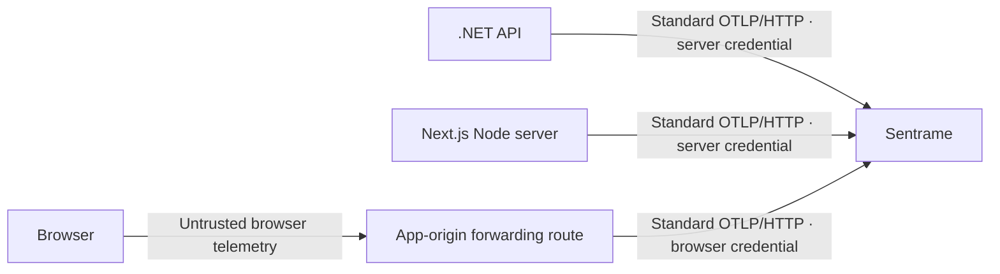

# Send OpenTelemetry to Sentrame from .NET and Next.js

**Your Next.js server does not need to send its telemetry through your .NET API.** Each server can use its own standard OpenTelemetry SDK/exporter and send directly to Sentrame. A shared OpenTelemetry Collector is an optional operational hop when you need centralized routing or buffering; your business API does not need to become a telemetry collector.



This guide is **source-checked configuration and example code**, not a claim that these .NET/Next.js exporters have been run against this release. Sentrame's current qualification covers the origin OTLP/HTTP combinations recorded in [local review](LOCAL-REVIEW.md), standard wire fixtures and the synthetic demonstrations. Actual SDK versions, browser behavior and the deployed HTTPS/tunnel route require their own checks. No WFS application was changed or contacted to write this guide.

## 1. Know which process is sending

| Where the event happened | What to configure | Credential |
| --- | --- | --- |
| .NET API/backend | .NET OpenTelemetry logging/tracing exporters | Server producer token, kept server-side |
| Next.js Route Handler, Server Action or rendering on Node | Next.js `instrumentation.ts` plus one Node OpenTelemetry provider | Server producer token, kept server-side |
| Browser click, screen entry, tab visibility or browser exception | Browser SDK plus an intentionally designed same-origin forwarding route | Sentrame browser producer token on the forwarding leg |
| Another viewer browsing Sentrame | Owner passphrase or temporary viewer invite | Viewer access; never use this for telemetry |

The receiver assigns `browser` or `server` authority from the configured producer credential. A `service.name`, an attribute saying “server”, or forwarding a browser record through a server cannot make the browser's claim authoritative. Use the **browser** credential when forwarding browser records. A browser saying “Vote clicked” differs from a trusted API saying “Vote persisted”.

A Next.js server is a server process. Configuring it does **not** collect browser clicks or client-component errors. A Collector also must preserve browser/server authority through separate authenticated pipelines; combining everything under the server token would lose that distinction.

## 2. Endpoint and authentication

Use your deployed Sentrame origin, for example `https://sentrame.your-domain.example`. For local development on the **same Mac**, use `http://127.0.0.1:8096`. `localhost` inside another container refers to that container; use a deliberately configured reachable address instead. The NAS package and tunnel boundary are described in [NAS.md](NAS.md).

| Signal | Full OTLP/HTTP endpoint |
| --- | --- |
| Logs, named events, custom error messages | `https://sentrame.your-domain.example/v1/logs` |
| Spans and span exceptions | `https://sentrame.your-domain.example/v1/traces` |
| Metrics receipt | `https://sentrame.your-domain.example/v1/metrics` |

Send `Authorization: Bearer <producer-token>`. Do not put tokens in URLs or use the owner's viewer passphrase as an ingestion credential. Metrics are currently receipt-only; they do not create individual journey steps or supported application-metric arithmetic.

For SDKs configured through standard environment variables:

```dotenv
OTEL_EXPORTER_OTLP_ENDPOINT=https://sentrame.your-domain.example
OTEL_EXPORTER_OTLP_PROTOCOL=http/protobuf
OTEL_EXPORTER_OTLP_HEADERS=Authorization=Bearer%20REPLACE_WITH_SERVER_PRODUCER_TOKEN
OTEL_SERVICE_NAME=your-api
OTEL_RESOURCE_ATTRIBUTES=service.version=1.0.0
```

The **common** HTTP endpoint is a base URL: standard exporters append the signal path. Signal-specific variables such as `OTEL_EXPORTER_OTLP_LOGS_ENDPOINT` instead take the **complete** `/v1/logs` URL. Explicit exporter URL options also need the complete signal URL; the examples below set those explicitly. `%20` encodes the space in the environment-header value. Keep real values in your deployment's secret configuration, not committed files or chat. [OTLP exporter configuration](https://opentelemetry.io/docs/specs/otel/protocol/exporter/) defines the endpoint/header behavior; the [.NET exporter guide](https://opentelemetry.io/docs/languages/dotnet/exporters/) shows the explicit `HttpProtobuf` options.

For the programmatic examples below, set these server-only application settings instead:

```dotenv
SENTRAME_OTLP_BASE=https://sentrame.your-domain.example
SENTRAME_SERVER_TOKEN=REPLACE_WITH_SERVER_PRODUCER_TOKEN
OTEL_SERVICE_NAME=your-api
SERVICE_VERSION=1.0.0
```

Those `SENTRAME_*` names are convenient configuration for the example application, **not required telemetry attributes or a proprietary SDK**. The code turns them into ordinary OTLP exporter options. Do not add a `NEXT_PUBLIC_` prefix to server credentials. Next.js documents that prefix as browser-exposed configuration. [Next.js environment-variable guidance](https://nextjs.org/docs/app/guides/environment-variables).

## 3. .NET: collect logs, exceptions and request traces

These snippets target ASP.NET Core with OpenTelemetry .NET **1.20.1**. Install compatible packages in the application you intend to instrument; these commands have not been executed against WFS:

```sh
dotnet add package OpenTelemetry.Extensions.Hosting --version 1.20.1
dotnet add package OpenTelemetry.Exporter.OpenTelemetryProtocol --version 1.20.1
dotnet add package OpenTelemetry.Instrumentation.AspNetCore --version 1.20.1
dotnet add package OpenTelemetry.Instrumentation.Http --version 1.20.1
```

The core packages are listed in the official [1.20.1 release](https://github.com/open-telemetry/opentelemetry-dotnet/releases/tag/core-1.20.1); [ASP.NET Core](https://www.nuget.org/packages/OpenTelemetry.Instrumentation.AspNetCore/1.20.1) and [HTTP instrumentation](https://www.nuget.org/packages/OpenTelemetry.Instrumentation.Http/1.20.1) have matching published versions. In an existing app, reconcile its package graph and lock files instead of registering a second OpenTelemetry provider. If it uses Serilog, NLog or another logging pipeline, verify the bridge for that pipeline; direct calls to a different logging API are not automatically captured by the `ILogger` setup shown here.

A small `Program.cs` integration:

```csharp
using System.Diagnostics;
using OpenTelemetry.Exporter;
using OpenTelemetry.Logs;
using OpenTelemetry.Resources;
using OpenTelemetry.Trace;

var builder = WebApplication.CreateBuilder(args);
var baseUrl = builder.Configuration["SENTRAME_OTLP_BASE"]
    ?? throw new InvalidOperationException("Set SENTRAME_OTLP_BASE");
var token = builder.Configuration["SENTRAME_SERVER_TOKEN"]
    ?? throw new InvalidOperationException("Set SENTRAME_SERVER_TOKEN");
var service = builder.Configuration["OTEL_SERVICE_NAME"] ?? "demo-api";
var version = builder.Configuration["SERVICE_VERSION"] ?? "unknown";

void ExportTo(OtlpExporterOptions options, string signal)
{
    options.Endpoint = new Uri(baseUrl.TrimEnd('/') + "/v1/" + signal);
    options.Protocol = OtlpExportProtocol.HttpProtobuf;
    options.Headers = "Authorization=Bearer " + token;
}

builder.Services.AddOpenTelemetry()
    .ConfigureResource(r => r.AddService(service, serviceVersion: version))
    .WithTracing(traces => traces
        .AddAspNetCoreInstrumentation()
        .AddHttpClientInstrumentation()
        .AddOtlpExporter(options => ExportTo(options, "traces")));

builder.Logging.AddOpenTelemetry(logs =>
{
    logs.IncludeScopes = true;
    logs.IncludeFormattedMessage = true;
    logs.SetResourceBuilder(ResourceBuilder.CreateDefault()
        .AddService(service, serviceVersion: version));
    logs.AddOtlpExporter(options => ExportTo(options, "logs"));
});

var app = builder.Build();

// A controlled local development check. Do not add an unauthenticated
// telemetry-trigger endpoint to a deployed business application.
if (app.Environment.IsDevelopment())
{
    app.MapPost("/internal/telemetry-demo/error", (ILogger<Program> logger) =>
    {
        try
        {
            throw new InvalidOperationException("Synthetic inventory lookup failed");
        }
        catch (InvalidOperationException error)
        {
            Activity.Current?.SetStatus(ActivityStatusCode.Error,
                "Synthetic inventory lookup failed");
            logger.LogError(new EventId(0, "demo.server.error"), error,
                "Controlled telemetry check failed");
            return Results.StatusCode(503);
        }
    });
}

app.MapGet("/", () => "Application running");
app.Run();
```

The explicit .NET `Headers` option above uses a literal space after `Bearer`; its pinned parser accepts that value and also decodes URL-encoded environment-header values. [Exact 1.20.1 header parser](https://github.com/open-telemetry/opentelemetry-dotnet/blob/core-1.20.1/src/OpenTelemetry.Exporter.OpenTelemetryProtocol/OtlpExporterOptionsExtensions.cs). The Next.js example uses a plain JavaScript headers object with the same literal space.

Run the development app and call its own `/internal/telemetry-demo/error` endpoint once. After the SDK's batch export, open **Sentrame → Errors** and look for `demo.server.error`, the configured service and a scrubbed exception message/stack. This tests logging; HTTP instrumentation supplies related technical spans. A server error can remain discoverable without a visit ID. Let the ASP.NET Core host shut down gracefully so its registered providers can flush queued telemetry.

The exporter serializes `ILogger` exceptions into standard exception fields and uses the named `EventId` as the OTLP event name. In the pinned exporter, the numeric logging-template ID is separately named `logrecord.event.id` when its experimental emission is enabled; it is not an occurrence identity. The sample's numeric zero avoids relying on that optional field. **Ordinary `ILogger` reception does not need a custom `event.id`.** [Pinned .NET log serializer](https://github.com/open-telemetry/opentelemetry-dotnet/blob/core-1.20.1/src/OpenTelemetry.Exporter.OpenTelemetryProtocol/Implementation/Serializer/ProtobufOtlpLogSerializer.cs), [pinned experimental option names](https://github.com/open-telemetry/opentelemetry-dotnet/blob/core-1.20.1/src/OpenTelemetry.Exporter.OpenTelemetryProtocol/Implementation/ExperimentalOptions.cs).

For a real business milestone, emit a named log **after** its actual operation succeeds:

```csharp
// In the trusted service, after the real persistence operation has completed:
logger.LogInformation(new EventId(0, "vote.committed"), "Vote persisted");
```

The name is discoverable even though ordinary informational bodies are not retained as diagnostic text. Use controlled event names; do not put recipe names, customer input, URLs or IDs into the name. This use of .NET structured logging follows the [OpenTelemetry ASP.NET Core logging model](https://opentelemetry.io/docs/languages/dotnet/logs/getting-started-aspnetcore/).

To illustrate optional **server-only operation** correlation across several named events:

```csharp
var operationVisit = Guid.NewGuid().ToString("N");
using (logger.BeginScope(new Dictionary<string, object?>
{
    ["session.id"] = operationVisit
}))
{
    logger.LogInformation(new EventId(0, "demo.operation.started"),
        "Synthetic operation started");
    // Run the actual operation here in your application.
    logger.LogInformation(new EventId(0, "demo.operation.completed"),
        "Synthetic operation completed");
}
```

The scope is a random operation value, not a logged-in user or household ID. This illustration does not perform or prove a real operation; in application code the completed event belongs after actual success. `IncludeScopes=true` exports the structured scope. Mapping the two names and choosing the completed event as goal can then produce a journey. Without correlation the valid records still remain received/discovered, with dependent journey interpretation unavailable.

## 4. Next.js: initialize one Node provider for traces and logs

This example uses the manual Node SDK path, **not `@vercel/otel` at the same time**. Next.js documents conditional Node-only initialization in `instrumentation.ts`; the Node SDK is not an Edge SDK. Existing `@vercel/otel`, monitoring-agent or OpenTelemetry setup must be reconciled before adding this provider. [Next.js instrumentation setup](https://nextjs.org/docs/app/guides/open-telemetry).

The example deliberately uses a coherent published OpenTelemetry JS **3.0.0 / 0.300.0** family and Node **22.15.0 or newer**:

```sh
npm install --save-exact @opentelemetry/api@1.10.0 \
  @opentelemetry/sdk-node@0.300.0 \
  @opentelemetry/sdk-logs@3.0.0 \
  @opentelemetry/resources@3.0.0 \
  @opentelemetry/exporter-logs-otlp-proto@0.300.0 \
  @opentelemetry/exporter-trace-otlp-proto@0.300.0
```

In this family the log API is exported from `@opentelemetry/api`, and `BatchLogRecordProcessor` takes an options object containing `exporter`. Do not mix this code with older `@opentelemetry/api-logs`/0.2xx examples. Check compatibility with your existing Next.js dependencies before upgrading them. [JS 3.0 release and migration](https://github.com/open-telemetry/opentelemetry-js/releases/tag/v3.0.0), [Node SDK dependency versions](https://github.com/open-telemetry/opentelemetry-js/blob/v3.0.0/experimental/packages/opentelemetry-sdk-node/package.json), [log processor constructor](https://github.com/open-telemetry/opentelemetry-js/blob/v3.0.0/packages/sdk-logs/src/export/BatchLogRecordProcessorBase.ts).

Place `instrumentation.ts` at the project root, or under `src` alongside `app` when the app uses `src`:

```ts
// instrumentation.ts
import type { Instrumentation } from 'next';

export async function register() {
  if (process.env.NEXT_RUNTIME === 'nodejs') {
    await import('./instrumentation.node');
  }
}

export const onRequestError: Instrumentation.onRequestError = async (error) => {
  if (process.env.NEXT_RUNTIME === 'nodejs') {
    const telemetry = await import('./instrumentation.node');
    await telemetry.reportServerError(error);
  }
};
```

`onRequestError` catches errors observed by the Next.js server, not browser exceptions. The hook's error may have been processed by React; it does not guarantee an original source stack. Do not serialize its request headers, cookies, URL query or request body. [Next.js `onRequestError` contract](https://nextjs.org/docs/app/api-reference/file-conventions/instrumentation).

```ts
// instrumentation.node.ts — server-only; never import from a Client Component.
import { context, logs, SeverityNumber } from '@opentelemetry/api';
import { NodeSDK } from '@opentelemetry/sdk-node';
import { BatchLogRecordProcessor } from '@opentelemetry/sdk-logs';
import { defaultResource, resourceFromAttributes } from '@opentelemetry/resources';
import { OTLPLogExporter } from '@opentelemetry/exporter-logs-otlp-proto';
import { OTLPTraceExporter } from '@opentelemetry/exporter-trace-otlp-proto';

const base = process.env.SENTRAME_OTLP_BASE;
const token = process.env.SENTRAME_SERVER_TOKEN;
if (!base || !token) throw new Error('Set server-side Sentrame exporter settings');
const headers = { Authorization: `Bearer ${token}` };
const endpoint = (signal: string) => `${base.replace(/\/$/, '')}/v1/${signal}`;

export const logProcessor = new BatchLogRecordProcessor({
  exporter: new OTLPLogExporter({ url: endpoint('logs'), headers }),
  scheduledDelayMillis: 1000,
});
const sdk = new NodeSDK({
  autoDetectResources: false,
  resource: defaultResource().merge(resourceFromAttributes({
    'service.name': process.env.OTEL_SERVICE_NAME ?? 'demo-next-server',
    'service.version': process.env.SERVICE_VERSION ?? 'unknown',
  })),
  traceExporter: new OTLPTraceExporter({ url: endpoint('traces'), headers }),
  logRecordProcessors: [logProcessor],
  metricReaders: [],
});
sdk.start();

export function reportBusinessEvent(name: string, attributes: Record<string, string> = {}) {
  logs.getLogger('app.journeys').emit({
    eventName: name,
    severityNumber: SeverityNumber.INFO,
    body: 'Application milestone',
    attributes,
    context: context.active(),
  });
}

export async function reportServerError(caught: unknown) {
  const error = caught instanceof Error ? caught : new Error('Non-Error value thrown');
  logs.getLogger('app.errors').emit({
    eventName: 'app.server.error',
    severityNumber: SeverityNumber.ERROR,
    body: 'Server operation failed',
    attributes: {
      'exception.type': error.name,
      'exception.message': error.message,
      'exception.stacktrace': error.stack ?? '',
    },
    context: context.active(),
  });
  // Await the hook's export work. Do not flush on every normal business event.
  await logProcessor.forceFlush();
}

// Call this from the application's existing orderly shutdown path. Do not
// install competing process.exit/SIGTERM handlers that bypass Next shutdown.
export const shutdownTelemetry = () => sdk.shutdown();
```

The provider is initialized once per Node server instance, before requests. Its exporters use **HTTP Protobuf** and explicit full paths. `reportBusinessEvent('checkout.opened')` in a server operation produces a standard named log; call it only where that server operation actually happens. `reportServerError(new Error('Controlled synthetic failure'))` is a simple controlled development check. The API's `eventName`, standard exception attributes and current active context are defined by the [pinned JS log record API](https://github.com/open-telemetry/opentelemetry-js/blob/v3.0.0/api/src/logs/LogRecord.ts); the [Node SDK registration implementation](https://github.com/open-telemetry/opentelemetry-js/blob/v3.0.0/experimental/packages/opentelemetry-sdk-node/src/sdk.ts) establishes its providers.

This does not make `console.error` automatically become an OTLP log. Bridge the application's logging library intentionally or call a small controlled adapter such as the functions above. Batch export can be lost on abrupt/serverless termination; integrate the host's supported flush/shutdown lifecycle. Do not run this Node provider in Edge or a Client Component.

## 5. Connect traces across Next.js and .NET

A trace/span ID answers “which technical operation is related?” It is different from an app visit, an action occurrence and a viewer login. HTTP instrumentation can propagate standard W3C `traceparent`/`tracestate`; it does not invent a business visit.

For a known trusted outbound API destination, Next.js can explicitly inject the active context into that request:

```ts
import { context, propagation } from '@opentelemetry/api';

const carrier: Record<string, string> = {};
propagation.inject(context.active(), carrier);
const response = await fetch(process.env.APP_API_ORIGIN + '/your-fixed-route', {
  headers: carrier,
});
```

Use a configured trusted destination, not a user-controlled URL, and add the application's normal authentication independently. Do not inject the Sentrame producer token into this business request. The .NET incoming instrumentation can continue that trace. This is technical propagation; an application must separately choose and explicitly carry permitted random business correlation when joining browser intent and server commitment. Do not put personal identity into baggage or infer a join from close timestamps. [OpenTelemetry context propagation](https://opentelemetry.io/docs/concepts/context-propagation/).

## 6. Add journey context only when you need it

Sentrame accepts ordinary valid standard telemetry **without** event IDs, session IDs, a custom schema or Sentrame fields. A useful exception can appear in Errors without any journey. A mapped event with insufficient journey context remains received/unassigned rather than fabricating a path.

| Optional field | What it supports | What to avoid |
| --- | --- | --- |
| Resource `service.name`, `service.version` | Distinguish API/Next services and releases | Using these self-asserted values as authorization |
| Record `session.id` | A random visit or bounded server operation | User, household, email, device or persistent analytics identity |
| Record `tab.id` | Keep browser tabs separate | One browser scope reused across tabs |
| Record `event.id` | A string identifying one emitted record, stable for exact retry | Static logging-template ID, regenerating on retry, or reusing one ID for different events |
| Record `action.id` | Random action linkage across related evidence | Treating it as a record ID or a person's identity |
| Record `stage.occurrence.id` | Pair one real stage start/end occurrence | Reusing it for repeated visits to the same stage |
| `stage.name`, `stage.state`, `activity.state`, `reason` | Safe bounded mapping/timing/exit meaning | Customer text, arbitrary payload objects or sensitive labels |
| Standard trace/span IDs | Technical causal context where propagation is verified | Treating a trace as an anonymous visit or viewer credential |

These are the fields currently projected by [the receiver](../internal/app/intake.go), not a requirement for basic OTLP reception. A producer SDK normally supplies timestamps; custom wire fixtures must use fresh occurrence times. A record's identity is separate from timestamp ordering and from the occurrence identity used to pair timing.

For browser journeys, generate a fresh random scope/tab in that tab's in-memory telemetry state after the application's collection/privacy decision. Rotate it when that anonymous visit ends; do not persist a tracking identity or join a later visit. For example, `const visit = crypto.randomUUID(); const tab = crypto.randomUUID();` inside a tab-local telemetry module. This is an instrumentation design choice, not a consent implementation. Sending the same safe random values to the backend for correlation must be an explicit application change with validated scope and retained browser/server authority.

An automatically recorded `GET /recipes` span is useful technical evidence. It is **not** automatically “Viewed recipe”, “Saved vote” or “Agreement reached”. Emit controlled semantic events at those actual milestones and map them in the workspace.

## 7. First useful integration, one observation at a time

1. Verify the deployed Sentrame origin and producer credentials with one controlled synthetic log through the intended route.
2. Send one controlled error from the selected real SDK; inspect **Errors** for the service, message, stack and standard trace/span context. Check that no sensitive values travelled to the receiver.
3. Emit one named business record at a real milestone. Find it under **Unmapped events**, select it, and choose **Configure event**.
4. Assign a short Stage and **step** Kind; preview matches before activating a prospective definition. Configure the intended operational goal separately.
5. Add only the random scope/tab/action context needed for the journey question, then verify ordered events, repeated actions, warnings/recovery and goal completion.
6. Exercise retries, process restart, exporter batching/loss and the actual deployed route before advertising SDK support. Test each service independently; successful .NET export does not qualify Next.js or browser export.

Condition filters refer to retained attributes: for an event with `{"reason":"exhausted"}`, set **Condition key** to `reason` and **Equals** to `exhausted`. Leave both empty when the event name and trusted producer are sufficient. The current general safe attribute allowlist includes `reason`, `stage.name`, `stage.state`, `activity.state`, `exception.type`, `exception.occurrence.id` and bounded SDK/runtime/environment metadata. Unknown attributes are omitted by privacy projection, not rejected solely for being unfamiliar.

### A manual standard wire check

This creates a **local payload file only**. Replace the destination and provide the server producer token in your shell's secret environment before deliberately running `curl`. It contains no journey-specific fields, so the expected result is a discovered accepted-unassigned error.

```sh
export SENTRAME_OTLP_BASE=http://127.0.0.1:8096
# Set SENTRAME_SERVER_TOKEN locally; do not paste a real token into this document.
python3 - <<'PY'
import json, time
from pathlib import Path
payload = {"resourceLogs": [{
    "resource": {"attributes": [
        {"key": "service.name", "value": {"stringValue": "manual-wire-check"}}
    ]},
    "scopeLogs": [{"logRecords": [{
        "timeUnixNano": str(time.time_ns()),
        "eventName": "demo.standard.error",
        "severityNumber": 17,
        "body": {"stringValue": "Controlled synthetic error for receiver setup"}
    }]}]
}]}
Path('/tmp/sentrame-wire-check.json').write_text(json.dumps(payload))
PY
curl --fail-with-body --silent --show-error \
  -H "Authorization: Bearer ${SENTRAME_SERVER_TOKEN:?Set the server producer token}" \
  -H 'Content-Type: application/json' \
  --data-binary @/tmp/sentrame-wire-check.json \
  --write-out '\nHTTP %{http_code}\n' \
  "${SENTRAME_OTLP_BASE%/}/v1/logs"
```

Expect HTTP200 with an OTLP response. An HTML login page or HTTP redirect from an access proxy is not successful receiver acceptance. This sends standard OTLP/HTTP **JSON**, not Protobuf binary. A successful wire check does not qualify a language SDK or prove a journey. The version-controlled [REST requests](../rest/) and fixture Taskfile commands provide richer repeatable Protobuf demonstrations, replay identities and read-path checks.

## 8. Privacy and debugging limits

Emit only controlled technical messages and necessary attributes. Default auto-instrumentation may include URLs or other context **before** Sentrame sees it; review sender-side minimization before real export, especially when a proxy/tunnel is on the path. Do not export request bodies, authorization/cookie headers, connection strings, tokens, SQL parameters, personal/business objects or customer text just because the receiver later filters fields.

Sentrame retains bounded scrubbed error bodies, exception messages and stacks under its current policy. Scrubbing is imperfect. INFO bodies and unknown attributes are generally omitted; source maps are not applied, stack/source lines are as emitted, and missing/sampled diagnostics do not prove absence of errors. Error severity does not automatically end a journey. Supported detail expires after 30 days; supported summaries retain 12 months and do not preserve expired individual stacks.

Browser forwarding is deliberately left as a reviewed integration boundary, not a generic unauthenticated JSON upload route in this guide. Use standard OTLP from the browser, validate/bound same-origin forwarding, preserve the browser producer namespace, and verify CSP/CORS/lifecycle behavior. Do not convert browser events into trusted server statements. The viewer passphrase, invite link and viewer cookies must never enter application telemetry.

## Qualification record

Source review on 2026-10-28 checked the current receiver field projection, .NET 1.20.1 package/exporter behavior, Next.js Node-only initialization/error hooks and the coherent JS 3.0.0/0.300.0 API family. These snippets have **not** been compiled, installed or run in a real .NET/Next.js application here. Actual SDK receipt, automatic propagation, browser forwarding, exporter shutdown behavior and the NAS/tunnel route remain checks to perform against the chosen application's locked versions. A source-checked recipe is useful setup guidance, not a passed compatibility cell.
