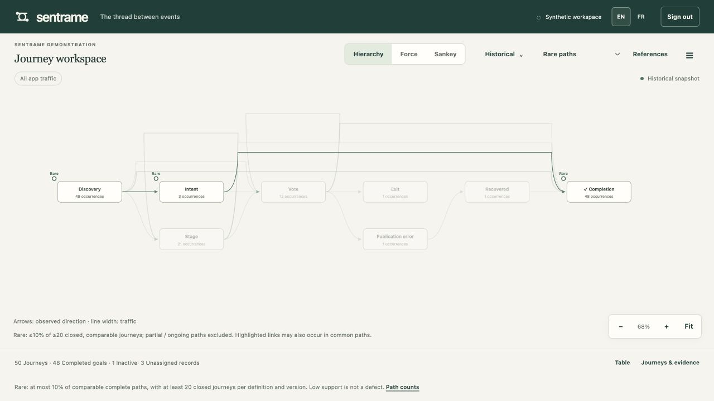
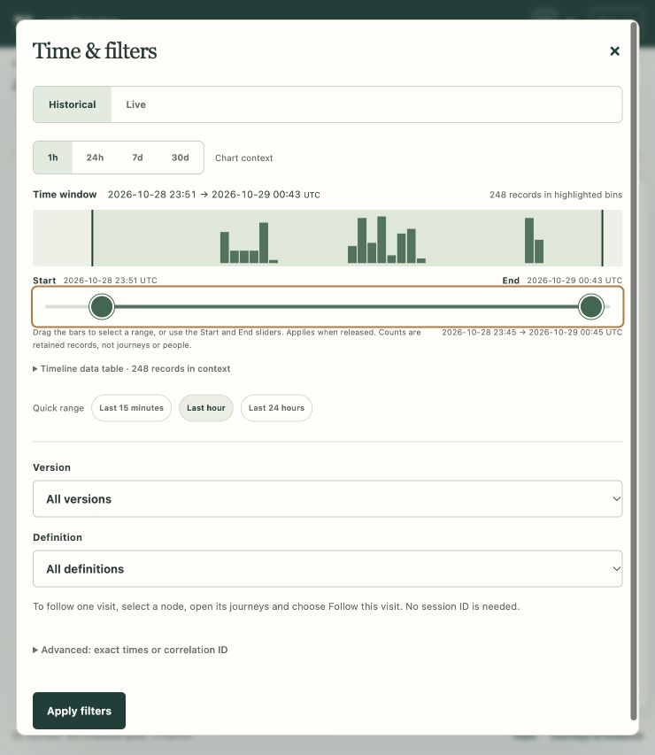
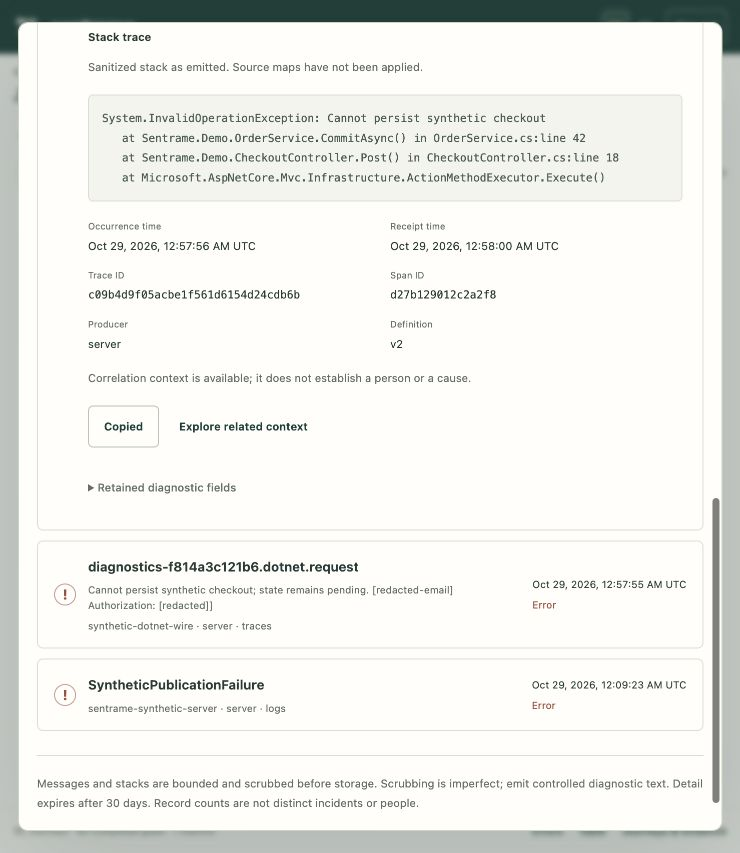

# Using Sentrame

Sentrame turns received application events into an explorable journey map. Use it to see what happened before and after a stage, find unusual routes, inspect errors, and compare live activity with recent traffic. A graph shows observed evidence; a missing connection, quiet visit or error does not by itself prove failure or its cause.

This guide uses the English interface labels. **EN / FR** changes the interface language. Screenshots below show synthetic review data, not a connected production application.

## Open the workspace

For the existing local review workspace, run this from the Sentrame repository and leave the terminal open:

```sh
task start:workspace
```

Open [http://127.0.0.1:8096](http://127.0.0.1:8096). Use the exact configured address: `127.0.0.1` and `localhost` are different origins for access checks. The owner signs in with the configured passphrase. The local setup stores it in the ignored `.sentrame/local.env` file as `SENTRAME_PASSPHRASE`; keep that file private. There is no shared default password.

A restart requires a new sign-in. For first-time installation, synthetic demonstrations and REST Client requests, use the [local setup and review guide](LOCAL-REVIEW.md). For container configuration, storage and network access, use the [NAS launch guide](NAS.md). Preparing a container does not establish that a particular NAS or external network route has been qualified.

## Choose your application

Sign in, choose **Add app**, enter a unique name and register. Connection settings open with generated browser/server credentials, masked until reveal or copy. Configure your existing standard exporter; no Sentrame SDK or app-ID field is needed. Server credentials stay server-side. New apps have empty mappings.

Use the app selector for separate products and **App settings** to rename, rotate a role or remove an app after typing its name. Each app has its own history, mappings, references, lifecycle and invitations. App URLs and tabs keep their own selection; switching closes old editors/streams and clears old app data. Journeys is first and opens by default for owners and viewers, including after switching from Traces. Explicit trace links and saved trace references open Traces. A journey empty state stays in Journeys with connection/mapping/correlation guidance.

Temporary invitations name the selected app and its read-only whole-app scope and lifetime. They do not grant app administration, other apps or credentials. See [storage, recovery and limits](MULTI-APP.md). This release is greenfield: register apps again in a fresh directory; old single-app data and credentials are not imported.

### What can appear automatically

**Traces** reconstructs native operation parents/timing from ordinary spans and trace-linked logs; no stage or visit fields are required. **Journeys** can also show goal-free browser navigation when a new app has an empty captured definition and named browser logs supply an anonymous session, tab and usable source order. Neither view infers a vote was saved or creates a completion goal. Explicit event-to-stage mappings control configured business meaning; choose a trusted emitted outcome as the goal only when you need that completion question. Server-only logs, metrics and nearby timestamps do not become browser navigation automatically. See the [integration guide](DEVELOPER-GUIDE.md#6-add-journey-context-only-when-you-need-it) before changing senders.

## Start with the graph

Start with **Choose an investigation task**: **How do observed stages connect?** keeps Hierarchy, Force and Sankey available; **Where do journeys go next?** opens the matrix; **Which activities repeat?** opens repeats; **Which ordered routes are shared?** opens sequence; **What happened in one journey?** opens the timeline. Each task names its question, counting unit and a next action. Select a node or connection for details; use **☰** for less frequent tools.

| View | When to use it | What its shapes mean |
| --- | --- | --- |
| **Hierarchy** | Follow progression from left to right. | Cards are stages; arrows show observed direction; thicker connections mean more transition occurrences. |
| **Force** | Explore connected groups, loops and less linear paths. | Circles are stages arranged into a settled network. It is not a continually moving simulation. |
| **Sankey** | Compare where traffic goes and how it splits. | Bar height and ribbon width represent occurrence volume on a shared scale. Returns and repeats remain visible. |

The workspace also offers four views of retained journey detail:

- **Journey timeline** shows a vertical story of ordered occurrences and linked diagnostics. Choose a journey with the keyboard and expand occurrence or diagnostic details with Enter. Relative times use the first available occurrence, not attention or measured time at a stage; exact occurrence, observed and receipt clocks remain in evidence details. Partial beginnings and uncertain/unplaced diagnostics stay explicit. Optional consecutive-repeat grouping starts off and expands back to the original ordinals; it never joins separate journeys or crosses source gaps.
- **Transition matrix** shows one primary metric: transition occurrences (default), affected journeys, affected visits or outgoing occurrence share. Nine Vote → Vote transitions in one journey/visit mean nine occurrences, one affected journey and one affected visit. Six A → B and four A → C transitions mean 60% and 40%, both with ten observed outgoing occurrences as denominator; hidden columns do not change it. A zero means no observed transition under complete retained coverage; a dash means unavailable or partial coverage, including an empty share denominator. The initial display has 12 stages, with search/inclusion up to 32; the ranked destination list is an alternative. Search covers retained source stages, not source data omitted by the server. Reorder changes displayed rank explicitly; Rescale updates the held linear intensity domain. Arrow keys move among cells, Home/End move within a row, Enter opens examples and Tab exits.
- **Repeats and returns** distinguishes extra occurrences, affected journeys, prevalence (repeating journeys / journeys reaching that stage) and intensity (extras per repeating journey). Ten Vote occurrences mean nine extras. Compare 20/100 reaching journeys with 8/10 using the visible denominators, without calling either a defect. Returns are direct transitions to a different stage previously observed in that journey. Partial beginnings can hide earlier occurrences; no observed return does not mean one never happened. Ranking can use affected journeys, prevalence or extras.
- **Sequence flow** shares captured prefixes rather than reconstructing routes from aggregate edges. Prefix support is journeys sharing that beginning, not disjoint exact-group membership. It initially shows three ordinal steps and five children per parent; explicit expansion remains bounded to 32 steps and 200 visible nodes. Other support, gaps, display caps, active/censored continuations and captured closures remain labeled. The ranked list has up to 20 display-limited groups with prefix evidence actions; these groups are not exact completed paths.

Live and baseline retain separate counts, labels and evidence actions. Live uses teal/solid identity and baseline slate/dashed identity, with text/badges as well as color. **Live / Baseline / Both** changes presentation without restarting observation. Both uses one scale; a selected visit versus app-wide history, incompatible definitions or partial source coverage prevents a supported difference comparison. Fixed seven-day baseline bounds do not freeze its counts: late evidence can correct that history. Query/source, graph and evidence-list limits are separate; a graph cap does not establish that ordered journey detail is incomplete. Exporter loss remains unknown. Check app, bounds, scope, version/definition and retained counts before comparing. Narrow filters or choose retained dates when detail is absent; a failed read is not zero traffic, and summaries cannot reconstruct expired sequences.

**Guide en français :** Le sélecteur de tâches permet de comprendre les connexions (Hiérarchie, Force, Sankey), voir les destinations (matrice), trouver les répétitions, explorer les débuts communs et inspecter un parcours. Vérifiez application, bornes, visite, version/définition, nombre de parcours et couverture. Une sélection d’un seul parcours ne représente pas tout le trafic. Élargissez les dates conservées ou retirez un filtre restrictif pour retrouver des détails ; une erreur de lecture ne signifie pas zéro trafic.

La matrice affiche une mesure principale : occurrences de transition par défaut, parcours concernés, visites concernées ou part des occurrences sortantes. Neuf Vote → Vote dans un parcours et une visite comptent neuf occurrences, un parcours et une visite. Six A → B et quatre A → C donnent 60 % et 40 % sur dix occurrences sortantes, même si une colonne est masquée. Un dénominateur vide est indisponible. Douze étapes sont affichées initialement, au plus 32 après recherche/inclusion ; la recherche porte seulement sur la source conservée. La liste classée propose les mêmes preuves. Flèches : déplacer la cellule ; Début/Fin : début/fin de ligne ; Entrée : exemples ; Tabulation : sortir. Réordonnez et réajustez l’échelle explicitement. Zéro, indisponibilité, source partielle et omission d’affichage sont distincts.

La prévalence des répétitions est parcours avec répétition / parcours atteignant l’étape : 20/100 et 8/10 ont des dénominateurs différents. L’intensité compte les occurrences supplémentaires par parcours avec répétition ; dix Vote donnent neuf supplémentaires. Le classement utilise parcours, prévalence ou supplémentaires. Un retour est une transition directe vers une autre étape déjà observée. Un début partiel peut masquer des occurrences antérieures ; aucun retour observé n’est pas une preuve d’absence ni de défaut.

Le flux partage des préfixes capturés : leur support n’est pas une somme de groupes disjoints. Affichage initial : trois étapes ordinales et cinq branches par parent ; expansion bornée à 32 étapes et 200 nœuds. La liste compte jusqu’à 20 groupes limités à l’affichage ; les exemples portent sur le préfixe, pas nécessairement un chemin complet exact. Suites actives/censurées, clôtures, lacunes et limites restent indiquées. Le regroupement de répétitions consécutives est désactivé par défaut, réversible avec les ordinaux d’origine, sans franchir une lacune ou un parcours. La chronologie verticale mesure le temps écoulé depuis la première occurrence disponible, pas l’attention ; les horodatages exacts et diagnostics non placés restent accessibles.

Direct (turquoise, trait plein) et référence (gris ardoise, pointillés) gardent leurs étiquettes et preuves séparées, même sans couleur. Direct / Référence / Les deux change l’affichage, pas le début d’observation. Les deux partagent une échelle ; une visite contre l’historique global, des définitions incompatibles ou une source partielle interdisent une comparaison de différence. Les bornes historiques fixes peuvent recevoir des corrections tardives. Limites de source, de graphe et de liste de preuves sont indépendantes ; les synthèses ne recréent jamais un détail expiré et les pertes de l’exportateur restent inconnues.

Traffic is not a count of people. One journey may visit a stage several times, so node occurrences, transition occurrences, journeys and visits can differ. A repeat such as Vote → Vote can be healthy repeated activity.

Click a node to open its inspector. **Incoming** shows observed connections into it; **Outgoing** shows connections from it. Select a neighboring row to inspect that connection. The inspector also shows stage counts, **Time at stage**, mapped event names and **Show journeys**. A connection inspector shows that transition’s counts and access to its ordered evidence. Selecting a node emphasizes its neighborhood; it does not delete other evidence.



### Move around without losing your place

- Drag empty space to pan. Two-finger scrolling also pans; pinch handlers support zooming at the pointer. Use **−**, **+** and **Fit** if gestures are unavailable.
- Drag a node to make a route easier to read. **Force** allows both axes; **Hierarchy** and **Sankey** keep their columns and allow vertical movement within routing bounds. Connections follow the node.
- A click opens the inspector; a drag does not. Each view keeps its own moved positions while that graph remains mounted. Reloading the page clears manual placement.
- **Reset layout** restores the current view’s automatic positions. **Fit** changes the camera to show the graph; it does not reset node placement.

For keyboard use, Tab to nodes and connections, then press Enter or Space to inspect them. With a node focused, Shift plus arrow keys moves it, subject to the view’s movement rules. With the canvas focused, arrow keys pan, `+`/`−` zoom and `0` fits. Keyboard focus remains visibly marked.

**Table** provides numeric map and timing alternatives. **Journeys & evidence** shows ordered paths and individual retained records. These views are also useful when many connections overlap. Physical trackpad, touch and assistive-technology behavior should be checked on the device you intend to use.

## Events, steps and activity

An **event** is an incoming telemetry record, such as `vote.committed`. A **mapping** gives that event a journey meaning. A **step** is one mapped occurrence in an ordered journey; a graph stage groups occurrences with the same stage label.

For example, ten separate `vote.committed` events mapped to **Vote** can produce ten Vote occurrences and nine Vote → Vote transitions. They do not become ten different stage names.

**Activity** is supporting evidence that does not add a step to the graph. An event saying a tab became hidden can help explain observed active time without cluttering the business path with another node. It remains evidence, not a measurement of a person’s attention.

Standard telemetry can be accepted without optional journey identifiers. Received records that cannot support a journey remain **Unassigned records**. Sentrame does not invent a visit or connection to make them fit.

If the historical timeline has bars but the journey graph is empty, those bars count **received records**, not journeys. When the selected range contains unassigned records, the empty graph confirms receipt and offers **View received records**. **Journeys & evidence → Unassigned records** opens automatically when there are no displayed journeys; it shows the event name, producer/signal, service/version, occurrence time and any emitted stage hint. **☰ → Unmapped events** also lists received event names across the retained app history.

A standalone log such as `pwa.app.opened` without a trace ID cannot appear in **Traces**. Without supported journey correlation, it also cannot become a journey merely by assigning a stage label. An empty trace list offers **View received records** to return to the journey workspace. For a live investigation, widen the historical range if the live observation began after the record arrived.

## Discover and configure events

Use **☰ → Unmapped events** to see received event names without mappings. **Show discovered events** puts them on the canvas as dashed, unconnected nodes. A disconnected discovery node means no journey relationship has been inferred; it does not mean the receiver failed.

Select an event node, then **Configure event…**. For an already mapped stage, find the event under **Events in this stage** and select it there. Each configuration field has an **ⓘ** button with guidance; click it or focus it and press Enter/Space.

| Field | What to enter |
| --- | --- |
| **Stage** | A short graph label, such as `Voting` or `Vote saved`. Several events may share a stage name. For a timing start/end pair, use the same stage name. Activity still requires a label, but does not add a graph node. |
| **Kind** | How this event affects the path or timing; see below. |
| **Trusted producer** | **Browser**, **Server** or **Any source**. Choose Server when the event must prove a server-side saved change. This filters by the receiver’s configured producer assignment; it does not make a browser claim trustworthy. |
| **Condition key** | Optional retained attribute name to test, such as `reason`. |
| **Equals** | The exact value required for that key, such as `exhausted`. It is case-sensitive literal text. |

### Choose the event kind

| Kind | Effect |
| --- | --- |
| **step** | Adds an occurrence to the journey path. Use for an action or milestone such as Vote saved. |
| **explicit exit** | Ends the journey with its emitted reason. Exhausting available recipes, for example, is not automatically a failure. |
| **stage start** | Adds an entry step and starts explicit stage timing. |
| **stage end** | Supplies the matching timing end without adding another graph step. |
| **activity** | Keeps supporting evidence without adding a graph step. Recognized `activity.state` values—`active`, `visible`, `idle`, `hidden`—can support observed active-time calculations. |

A native span uses its own start/end and native identity. Explicit paired timing is an alternative for a broader interval and needs compatible start/end evidence with the same stage label, emitted `stage.occurrence.id`, producer and service. Changing the Kind dropdown alone cannot supply missing instrumentation. All mapped kinds refresh the inactivity timeout. An ordinary mapped step may instead have **Next-event estimated** timing when that policy is enabled; that is an estimate, not an observed end.

### Use conditions only when necessary

Leave **both Condition key and Equals empty** to match this event by name and selected producer alone.

Suppose **Received examples** shows this attribute on `journey.exited`:

```json
{"reason": "exhausted"}
```

Enter:

| Condition key | Equals |
| --- | --- |
| `reason` | `exhausted` |

That matches `journey.exited` records with `reason` equal to `exhausted`. A record with `reason: agreed`, or no `reason`, does not match this example. Type `exhausted` without quotes; do not enter the whole JSON object or `reason=exhausted` in Equals. `Exhausted` is a different value.

Another example is **Condition key:** `activity.state`, **Equals:** `hidden`. Use keys and values actually present in **Received examples**. Attributes removed by the privacy policy cannot be used in conditions.

Matching records and configuration checks update automatically as you edit. Review the received-record section, then choose **Activate new definition** once the checks pass. It explains whether matching records have the session and browser-tab IDs needed for journeys. Activation creates a prospective definition; it does not rewrite existing captured journeys under the new rules.

Use **☰ → Mappings & goal** for the active configuration and **Set operational goal**. The operational goal is the event that completes future journeys. Merely investigating a stage or error does not make it a goal. A captured journey starts at its first mapped occurrence, completes at its configured goal, or closes as inactive after 30 minutes without mapped activity. The next genuine mapped occurrence starts a new journey. Inactive means the outcome is unknown, not failed. Ongoing captured journeys retain their original definition.

## Select a time range or follow one visit

Select **Historical** or **Live** to open **Time & filters**. In Historical mode, histogram bars show retained record counts by occurrence time. They do not count journeys, people, or metric values.

1. Choose a chart context: **1h**, **24h**, **7d** or **30d**.
2. Drag across bars, or move the **Start** and **End** handles.
3. Release to apply that interval to the graph. Green marks only the included span.

The chart context is independent of the graph selection, so you can see surrounding traffic while choosing a narrower slice. If existing dates extend beyond the chart, the handles show their visible portion; the graph keeps its range until you choose a new one. **Timeline data table** gives the counts numerically. **Quick range** offers recent intervals, and **Advanced: exact times or correlation ID** exposes precise bounds and known-ID search.

Dates are **UTC**, including the advanced fields, regardless of your computer’s timezone. The range includes its start and excludes its end: `10:00 → 11:00` includes an event at 10:00 but not one at exactly 11:00. A graph slice preserves window gaps instead of joining stages across omitted evidence.



You do not need to know a session ID to follow a visit. Select a node, choose **Show journeys**, identify a journey by its path, time and outcome, and use **Follow this visit** or **Follow this operation**. The selected scope appears above the graph with an **X**. Clear it to return to all traffic under the other filters. A correlation ID groups related events; it is not a person’s identity, and it should not be reused to join separate visits.

## Highlight a pattern

The **Highlight** label describes the dropdown’s purpose: emphasize matching evidence while other parts of the graph fade. Highlighting does not remove data or change journey outcomes.

| Option | What it emphasizes |
| --- | --- |
| **None** | Normal graph emphasis. |
| **Rare paths** | Full sequences with at most 10% share among at least 20 comparable closed journeys under the same definition and version. Partial, ongoing and right-censored paths are excluded from this rarity cohort. |
| **Endings** | Stages where journeys are pending, inactive, explicitly exited or completed. Different outcomes remain named. |
| **Warnings & exceptions** | Journeys containing warning or error evidence. |
| **Recovery** | Journeys with observed error/recovery evidence that later completed. |

Rare does not mean defective. A highlighted link may also belong to a common path; rarity is based on the whole sequence. With fewer than 20 eligible comparable journeys, Sentrame does not guess which paths are rare.

Red connections identify local error-related transitions, with text/symbol equivalents and access to evidence. An error in one part of a journey does not make every subsequent connection red or undo a later completion.

## Read and copy a supported observation

The **Supported observation** section describes the selected stage, direct transition, repeat, captured prefix or exact group in its own population. Select a cell or **Matching journeys** to choose the criterion, then use **Inspect supporting examples**. A transition states its selected metric and the full observed outgoing-occurrence denominator, including destinations hidden by the stage display. For example, `A → B: 60.0% outgoing occurrence share; 10 observed outgoing occurrences from A` means six of the ten retained outgoing occurrences from A went directly to B. It does not compare raw traffic windows.

For repeats, ten Vote occurrences in one journey produce **nine extra occurrences**, **1/1 journeys reaching the stage**, and **9.00 extras per repeating journey**. One additional journey containing Vote only once changes the reaching denominator to two, without changing the nine extras. Prefix support counts journeys sharing that recorded beginning; exact-group support requires the whole captured path to match. Counts describe the current retained selection. Fewer than 20 supporting journeys is labeled **Low support**; partial beginnings, source gaps or a capped source scan are labeled **Partial evidence**. A return or repeat alone proves no defect, abandonment or cause. Goal-free navigation does not acquire a conversion rate.

Choose **Copy investigation summary** explicitly to copy a local JSON projection: app and population, exact available UTC bounds, scope/version/definition filters, selected criterion, observation units/counts/denominator, independent source-scan and received-record list limits, read freshness/last successful display, population coverage and up to 20 currently retained journey/trace references. The received-record list remains labeled as the current-query projection even when copying a baseline observation; its cap does not reduce the transition denominator. Stale, paused and unavailable reads stay explicit. Exporter completeness stays unknown. Raw event bodies, diagnostic attributes, credentials, invitation tokens, request URLs and arbitrary snapshot fields are omitted. Credential-like values in labels are redacted. Review the displayed sanitized text before sharing it elsewhere; sanitization cannot establish that every owner-provided label is safe. Copying creates no public link and sends no message. Clipboard success or failure is visible; the displayed sanitized text provides a manual-copy fallback. Expired or deleted examples become **unavailable** and are not restored into the summary from navigation history. Existing copies on your clipboard remain outside server erasure.

From an example timeline, expand **Evidence details**, then choose **Open retained trace** when a retained trace ID is supported. **Back to journey investigation** restores the originating population, selected criterion and compatible investigation state. Close the example dialog to return focus to its invoking action. Missing or expired live detail never silently substitutes a baseline example; choose the separately labeled baseline action explicitly.

**Observation et copie en français :** La zone **Observation étayée** décrit l’étape, la transition directe, la répétition, le préfixe enregistré ou le groupe exact sélectionné dans sa propre population. Sélectionnez une cellule ou **Parcours correspondants**, puis **Examiner les exemples étayés**. Une part sortante de 60 % avec un dénominateur de dix signifie six occurrences directes sur dix départs observés, destinations masquées comprises. Dix occurrences Vote dans un parcours donnent neuf occurrences supplémentaires, 1/1 parcours atteignant Vote et une intensité de 9,00 supplémentaires par parcours répétant. Un autre parcours avec Vote une fois donne 1/2 parcours atteignant Vote, sans changer les neuf supplémentaires. Le support d’un préfixe inclut les continuations ; un groupe exact exige le chemin enregistré entier. Moins de 20 parcours est un **Support faible** ; débuts partiels, lacunes ou analyse source plafonnée sont des **Preuves partielles**. Une répétition ou un retour ne prouve ni défaut, ni abandon, ni cause ; la navigation sans objectif ne crée pas de taux de conversion.

**Copier le résumé de l’investigation** produit localement une projection JSON : application, population, bornes UTC disponibles, filtres de portée/version/définition, critère, mesure/compte/dénominateur, limites source/liste reçue indépendantes, état de lecture/dernier affichage réussi, couverture de population et au plus 20 références actuellement conservées. La liste reçue reste explicitement celle de la requête courante, même pour une observation de référence ; son plafond ne réduit pas le dénominateur. Lecture obsolète, en pause ou indisponible reste explicite. L’exhaustivité de l’exportateur reste inconnue. Corps et attributs bruts, identifiants secrets, jetons d’invitation, URL de requêtes et champs arbitraires sont omis ; les valeurs ressemblant à des secrets dans les libellés sont masquées. Vérifiez le texte affiché avant de le partager : le masquage ne garantit pas la sûreté de tous les libellés. Cette action ne publie aucun lien et n’envoie aucun message. Succès ou échec du presse-papiers est visible ; le texte nettoyé affiché permet une copie manuelle. Les exemples expirés/supprimés deviennent indisponibles, sans restauration de leur détail depuis l’historique ; une copie déjà conservée sur le presse-papiers ne peut pas être rappelée.

Depuis la chronologie d’un exemple, développez **Détails des preuves**, puis ouvrez la trace conservée si elle est disponible. **Retour à l’investigation du parcours** rétablit population, critère et état compatible. Fermer le dialogue replace le focus sur l’action initiale. Un exemple en direct indisponible n’est pas remplacé silencieusement par la référence : choisissez son action distincte.

## Explore and save references

Start from the question you want to investigate:

- Select a stage, then **Paths into here…** to look backward toward it.
- Select **Paths from here…** to inspect later recorded paths.
- Choose **Use as beginning…**, then select an end stage to explore a bounded segment.
- Use **References** to save the current investigation, or choose **Current workspace** for the whole current view.

Exploring these projections is read-only and does not require saving. A reference is a reusable query, not a new journey definition. Saving retains the time bounds, visit/version/definition filters, selected layout and highlight. Beginning/end modes allow the first or last repeated endpoint. **Open view →** applies the saved context. **Clear reference** returns to the ordinary filtered workspace.

References preserve captured journey boundaries. They cannot merge separate captured journeys, fill missing starts or resurrect expired detail. A live reference saves a fixed observation window; it does not save a combined live-plus-baseline dataset.

References also save a validated presentation version: primary metric, at most 32 included stage names, ranking/order and consecutive-repeat grouping. Old references with no preferences use occurrences, automatic traffic order and grouping off; repeats start with affected-journey ranking. Unsupported preference versions/values fall back visibly to those defaults while retaining the safe query. Invalid or overlong new preferences are rejected. No raw examples, scroll/return stack, paused snapshot or stream cursor is saved.

Saving live fixes both historical bounds and `evidence-window` eligibility: a journey begun earlier can still appear through evidence inside those bounds. Reopening is historical and never resumes observation. Older references default to `captured-start` eligibility. Unknown eligibility policies fail closed. On rollback, old binaries ignore unknown optional presentation fields and retain stored references; an unsupported layout retains the older workspace's supported layout (Hierarchy in a fresh workspace). They cannot explain unsupported preferences or reproduce the newer `evidence-window` eligibility: old captured-start queries can omit continuations begun before the window. Preserve the stored reference and reopen with a compatible version for that interpretation. This is a compatibility limitation, not equivalent historical results on an old binary.

**Réutilisation en français :** Les références conservent mesure, au plus 32 étapes, classement/ordre et regroupement, avec validation côté serveur. Sans préférences : occurrences, ordre automatique par trafic, regroupement désactivé ; les répétitions commencent par parcours concernés. Une version/valeur inconnue utilise des valeurs par défaut avec explication ; une nouvelle préférence invalide est rejetée. Aucun exemple brut, retour/défilement, instantané en pause ou curseur de flux n’est enregistré. Sauver le direct fixe des bornes historiques et la sélection `evidence-window`, incluant les preuves dans la fenêtre de parcours commencés avant ; rouvrir ne reprend pas le direct. Les anciennes références utilisent `captured-start` ; une politique inconnue est refusée. Un ancien binaire conserve les champs stockés mais ignore les nouvelles préférences et ne peut pas reproduire `evidence-window` : des continuations antérieures peuvent manquer. Utilisez une version compatible pour cette interprétation. Les visiteurs temporaires explorent sans pouvoir enregistrer ou supprimer.

Owners can choose **Delete reference** on a saved card, then confirm or cancel. This removes only that saved query. It does not delete collected events, journeys or other references. Temporary viewers may open references and investigate paths, but cannot save or delete them.

## Watch live activity

Switch to **Live** to begin an observation window. The current server sends a reset/snapshot wake-up every five seconds; it does not emit a notification per ingested event or replay counted deltas. The client coalesces wake-ups and reads an authorized snapshot. A routine reset is reconciliation; reconnect or an unexpected context/cursor change discloses a continuity gap until a successful snapshot. Notification counts never mean record counts.

- With **Seven-day baseline** off, view the clean live window.
- Turn it on to compare against the selected app’s fixed seven days before live start. Baseline and live volumes are counted separately; a selected visit does not turn the baseline into a single-visit baseline.
- **Pause updates** pauses viewing, not ingestion. **Resume updates** reconciles the view with current evidence.
- Transport connection, pending snapshot, last successful display time and stale/failed reads are distinct. A connected stream does not prove fresh data. Paused queued-record counts are unknown. Access expiry, revocation, deletion and retention still invalidate removed detail while paused; Back cannot restore it.
- **Follow latest** starts off. Choosing a journey or navigating manually suspends it. Reorder is explicit; updated traffic should not move the row being read. Recent live cues expire without changing live provenance; a correction inside baseline bounds is separately labeled. “Not observed in baseline” describes available evidence, not a newly invented stage or proof of absence.

**Direct en français :** Les signaux SSE actuels sont des réconciliations `reset` toutes les cinq secondes, pas un signal par événement ni un rejeu de compteurs. Le client regroupe les signaux et relit un instantané autorisé. Une reconnexion ou un contexte/curseur inattendu signale une lacune de continuité jusqu’à une lecture réussie ; une réconciliation périodique ordinaire n’est pas cette lacune. Connexion, lecture en cours, dernier affichage réussi, obsolescence et échec restent distincts. Pause arrête l’affichage, pas la collecte ; la quantité en attente est inconnue. Reprise relit les données, sans changer les bornes de référence. Expiration, révocation, suppression et rétention invalident les détails même en pause ; Retour ne les ressuscite pas. Suivre le plus récent est désactivé initialement et suspendu par la navigation manuelle. Réordonner reste explicite. Les corrections de référence sont séparées des arrivées en direct ; non observé dans la référence ne prouve pas l’absence.

Buffering, sampling, retries and clock differences can delay or omit observations. A quiet live screen does not establish that nobody is using the application. An ongoing stage’s provisional time is separate from completed-duration statistics.

## Inspect errors and time honestly

**Errors**, or **☰ → Errors & exceptions**, opens application-wide diagnostics. You do not need to be the person using the application, and an error does not need a visit ID to be discoverable.

Choose **Whole application** or **Current graph filters**, search by message, exception, service or trace ID, and expand a record. Inspect its message, available stack, producer, occurrence/receipt times and technical IDs. **Explore related context** follows available correlation; proximity alone is not proof that an error caused a particular result. **Copy sanitized context** copies the retained projection.

Messages, exception stacks and custom error-log bodies are bounded and scrubbed. Some details may have been omitted or truncated; earlier records can lack fields removed by an older policy. Stacks are shown as emitted, without applying source maps. Scrubbing is imperfect: controlled technical messages are appropriate, customer content and secrets are not. Synthetic .NET-like and Next.js-like examples do not qualify actual .NET or Next.js exporters.



In **Time at stage**, compare values only when their basis and definition are compatible:

| Timing basis | How to interpret it |
| --- | --- |
| **Measured elapsed** | Explicit entry-to-exit wall-clock duration. It may include idle or background time. |
| **Observed active** | Duration supported by explicit activity intervals, with bounded heartbeat assumptions. It does not measure attention. |
| **Next-event estimated** | An enabled fallback using adjacent compatible evidence. It is not an explicit stage end. |

**Median** describes the middle completed sample. **Slower cases (p90)** requires at least 20 completed compatible samples; ongoing, missing or excluded observations are not zero. Review sample count, exclusions and completeness alongside any duration. Missing clocks, mismatched occurrences or incomplete boundaries can make timing unavailable. Occurrence time, receipt time and **Receipt lag** answer different questions; clocks may differ.

## Retention, collection health and limits

Open **☰ → Data lifecycle** for retention and summary information.

- **Ordered detail:** 30 days by occurrence time, with a disclosed receipt-time fallback where supported. Expired records no longer appear in detailed reads.
- **Retained summaries:** supported app-wide whole-UTC-day counts and timing distributions for 12 calendar months. They cannot reconstruct old individual paths, visits or arbitrary new filters. Summary timing quantiles are approximate histogram bins; daily medians are not averaged.
- **Collection health:** reported completeness, privacy, freshness and verified-transport policies. It is not a live guarantee that every exporter event arrived.
- **Limits:** work caps for one view, including a 10,000-record model scan and 2,000 returned evidence records. The graph and error workspace have their own bounded displays. The visible **Coverage and display limits** separates the source scan, each population’s partial beginnings and censored continuations, the server graph projection, additional graph display omissions, and the received-record list. Only source/population limitations make ordered metrics partial; graph or received-record list caps do not reduce their denominators. Exporter sampling and delivery completeness remain unknown even when the scan is not capped. Narrow filters or inspect matching journeys for retained detail beyond a display. These caps are different from retention.

La zone **Couverture et limites d’affichage** distingue l’analyse source, les débuts partiels et continuations censurées de chaque population, la projection serveur du graphe, ses omissions d’affichage supplémentaires et la liste des enregistrements reçus. Les limites du graphe et de la liste ne réduisent pas les dénominateurs des parcours ordonnés. Une analyse source non plafonnée ne prouve pas une livraison exhaustive : l’échantillonnage et les pertes de l’exportateur restent inconnus. Affinez les filtres ou examinez les parcours correspondants au-delà des limites d’affichage.

The correction horizon ends at captured journey start plus 30 days. After detail expires, Sentrame cannot subtract one individual’s contribution from finalized summaries. Owner deletion tools distinguish a retained visit, a whole UTC summary day, and **Delete app data and disable intake**. Confirm the intended scope before proceeding. Whole-app deletion disables that intake generation. Client copies, filesystem snapshots and backups are outside server erasure guarantees; visit/journey correlation does not provide unlimited replay protection.

## Invite a temporary viewer

Owners open **☰ → Temporary viewers**:

1. Add an optional **Viewer label**, such as Product review.
2. Choose **Access expires after**: **1 hour**, **24 hours** or **7 days**. The default is 24 hours, and the clock starts when the link is created.
3. Choose **Create invitation link**, then **Copy invitation link**. Copy it now; Sentrame does not show the original link again from the saved invitation list.
4. Send it privately to the intended viewer. Anyone holding the link can redeem it once. To end access early, find the entry under **Invitation access** and select **Revoke access**.

The viewer opens the link and explicitly chooses **Open read-only workspace**. The invitation credential is removed from the address bar before normal app requests. If already signed in as the owner, sign out first or open the invitation in a separate browser profile; an invitation does not downgrade the owner’s current access.

A temporary viewer can browse the whole selected application’s retained history, live maps, baseline, references, errors and sanitized diagnostic details. They may change their own view filters, layout and highlights, follow a visit, and copy displayed sanitized evidence. They cannot change mappings or goals, save/delete references, delete collected data, or create/revoke invitations. The server enforces these restrictions independently of hidden buttons.

The viewer sees **Read-only access** and an expiry time. Expiry or revocation blocks subsequent protected requests; active live streams are checked within five seconds. The open app rechecks access even while historical viewing or live updates are paused. Once access ends, it clears the workspace and asks for a new invitation. Previously copied information cannot be recalled.

Viewer sessions also end on service restart. A redeemed link stays used and cannot sign in again; create a new invitation if access is needed afterward. An unused, unexpired, unrevoked invitation can still be redeemed after a restart.

A `127.0.0.1`, `localhost` or loopback IPv6 link works only on the machine opening it. Creating an invitation does not expose the service to another computer. An external viewer needs an already configured, reachable address and the correct origin; see the [NAS guide](NAS.md). Actual external-route and Home Server qualification remain separate.

## When the screen does not show what you expected

| Symptom | What to check |
| --- | --- |
| Empty graph | Clear a selected visit/reference, widen the time range, check the version/definition filters, then inspect **Unmapped events** and **Unassigned records**. Successful receipt without safe journey context is different from ingestion failure. |
| Event appears but has no connections | It may be unmapped or lack supported correlation. Configure its meaning and inspect received context; do not infer a link from nearby timestamps. |
| No rare-path highlight | At least 20 closed, comparable, non-partial/uncensored journeys are needed. A low count is not evidence that all paths are common. |
| Timing is unavailable | Check native span start/end or the explicitly selected pair, compatible source/clocks and completed samples. For p90, check the 20-sample minimum. |
| Counts differ between histogram and graph | The histogram counts retained records; graph nodes/edges count mapped occurrences/transitions. Journeys and visits are separate units. |
| Results say partial or capped | Read the separate coverage rows. A source/population limitation means observed partial counts; graph/list omissions affect that projection only. Narrow the period or filters, or inspect matching journeys. Exporter completeness remains unknown. |
| New UI is not visible | Refresh to load built browser assets. A backend change needs a service restart; restarting requires sign-in again. |
| Viewer link no longer works | It may be expired, revoked or already used, or its redeemed session may have ended on restart. Ask the owner for a new link. |
| Another device cannot open a local invite | Loopback points at that other device, not this service. Review the configured reachable address; an invite cannot create network access. |
| Real exporter sends nothing visible | Check the protected receiver’s advertised signal/HTTP combination, producer credentials and emitted timestamps/context. Use the setup/integration guides; this UI cannot establish delivery completeness. |

For repeatable sample traffic and actual OTLP request files, return to the [local review guide](LOCAL-REVIEW.md). Qualification notes distinguish what was source-tested, exercised locally or not run; do not treat a demonstration as proof of every SDK, route or device.


## Trace exploration

After sign-in, **Traces** lists observed execution contexts, with service and observed-span counts. Select one, then choose **tree**, **timeline** or **table**. Parent edges describe native context; parallel children never become chronological transitions. Missing and ambiguous targets stay labeled. Open **Typed relationships**, **Span events in export order** and **Correlated logs** for retained context. Logs with only a trace ID remain trace-level evidence. **Copy sanitized trace** copies the same protected projection.

Exact start/end and duration nanoseconds remain decimal strings. Durations are inclusive operation time, not exclusive time, page dwell, attention or a sum of unique time. Missing ends are right-censored; invalid or receipt-fallback clocks are unavailable. Sampling, SDK drop counts, projection link omissions and read truncation disclose partial evidence. A sampling flag supplies no sampling rate. Turn off **Automatic refresh** to pause updates; Refresh reconciles a full bounded read. Revocation clears access through the shared session boundary.

Switch to **Journeys** for configured chronological business paths. Trace-only telemetry does not create a journey, person count or conversion funnel. The two modes preserve separate counting units. Service/carrier contextual mappings and explicit definition previews are available at the qualified local seam; optional stage hint suggestions are available for explicit owner acceptance. See [qualification](verification/standard-otel.md) for what actually ran; wire tests do not qualify a browser exporter.


## Give ordinary telemetry business meaning

Received logs also offer **Configure event** directly under **Unassigned records**. The editor fills in the received service, producer and carrier when there is one observed context. When an event exists in several contexts, choose **Received event context** to select the actual service and producer; exact service suggestions are also available. **Received records for this mapping** loads automatically from retained app-wide history, independently of the graph time range. It shows the matching count and up to five recent examples with their retained attributes. **Pick a condition from received data (optional)** fills both Condition key and Equals from an observed field/value, with its occurrence count. Leave both fields empty to match all records in the selected context. If a condition matches nothing, the editor shows examples and alternative values from that context before the condition. Choices are limited to 64 retained, allowlisted field/value pairs, with omissions disclosed. Changing a condition, selector or goal automatically rechecks the complete draft; activation stays disabled until the current check passes. Use the dedicated **Completion goal** section in **Mappings & goal** to choose an event that proves success, including an unmapped received event. The editor selects **Use this event as the completion goal** and offers **Activate completion goal** after automatic validation. A goal is optional and separate from an exit or dead end. The activation button explains unmet stage, validation or conflict requirements. Failed checks offer **Retry check**. Missing correlation is reported separately and does not block saving a valid definition; those records remain unassigned.

On a trace operation, span event or log, choose **Give business meaning**. The editor starts with the retained exact service/carrier/source/name. Enter a literal Stage label, choose Kind and an optional retained key/value condition, then review the automatically updated matches and validation before activation. Select **Use this event as the completion goal** only for the intended successful outcome. No stage tag is needed. A trusted `vote.committed` span event can map to **Vote saved** while a similarly named log remains separate.

Native-span timing measures inclusive operation elapsed time using native identity. Point observations have no duration by label. Explicit paired boundaries and next-event estimates are separate policies; a broader page stage needs real supporting observations. Do not sum nested operations into unique page time. An end-boundary span goal requires a valid completed span; a named event goal uses its event timestamp. A generic successful HTTP request and browser intent do not prove persistence.

Default trace labels use capture-time definitions. Use the interpretation menu for an explicit non-persisting preview under another definition. Activation changes future captures, without rewriting retained evidence, previous labels or captured journeys. Two matching explicit rules block activation; there is no hidden rule order. Read-only viewers may inspect previews but cannot configure or activate.


## Optional emitted label suggestions

An unmapped record may offer **Use emitted suggestion: voting.persist**. Choosing it fills a literal Stage in the editor; Preview and activation remain required. There is no automatically activated mapping. Different emitted labels remain separate suggestions, with at most32 per contextual selector and omissions disclosed. Missing/invalid tags offer none and do not prevent ordinary-name mapping.

One explicit owner mapping always wins. If the emitter says `voting` while the owner says **Vote saved**, the stage remains **Vote saved**, and the emitted hint remains inspectable. Two overlapping explicit rules must be disambiguated. Child records do not inherit a span's label. Changed emitted hints do not rename prior captures or establish a goal, Kind, session or authority.


## Scoped native timing and references

Explicit scope/tab can relate multiple request traces into one configured journey. The graph counts chronological stage occurrences; opening a trace still shows its native operation structure. Native span timing now appears as **Native inclusive operation**, separate from **Measured elapsed**, **Observed active** and **Next-event estimated**. Each distribution carries its definition/computation, sample count and exclusions; p90 needs20 compatible completed samples. Missing ends/invalid clocks do not become zero samples, and competing timing bases for the same occurrence are unavailable until the owner chooses one.

In Traces, choose or save a **Trace reference** with a name, current view and definition interpretation. It stays distinct from journey goal/segment references. An explicit preview pins that definition; the default uses recorded capture context. Expired/deleted targets remain unavailable even when the saved query survives. A late earlier mapped prefix within the supported inactivity gap retains the known capture definition instead of adopting the latest labels. No personal identity index is created.

Observed-active time requires actual browser visibility/idle observations within a complete native browser interval or an optional paired page interval in the same capture. It measures capped positive observed intervals; gaps remain unknown, and server operation time cannot borrow browser presence.

The ranked path list shows at most 20 display-limited groups, with omitted group/member counts and **Browse all retained paths** for further evidence. It separates displayed-group membership and share of all retained journeys from shared-prefix support and exact whole captured-path support. Exact captured paths are not claims of completed journeys. Use the independently labeled prefix or exact actions; their supporting populations overlap and must not be added. Graph inspectors use the same population-specific matching examples, timeline, retained diagnostics and trace-return flow as the tables.

Graph error markers keep the affected population visible as `L!` and/or `B!` beside each connection. They mark retained error evidence, while solid Live and dashed Baseline contributions preserve their population colors and occurrence widths. An error marker does not classify the whole journey as failed.
