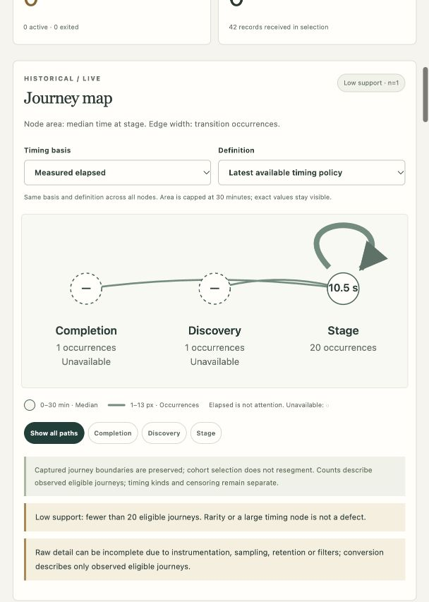
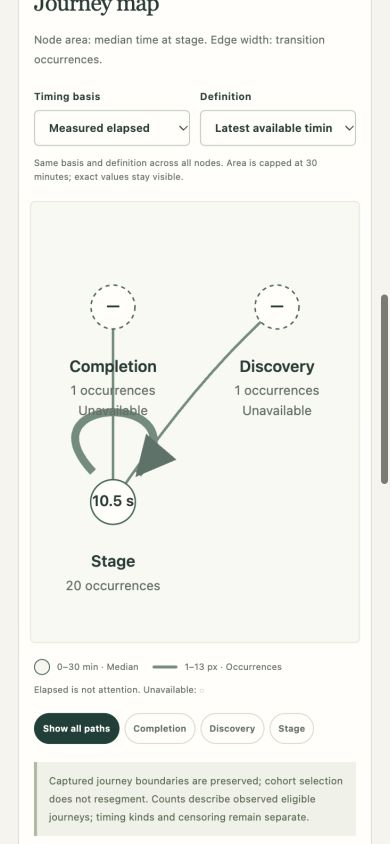

> Later owner-approved workspace and diagnostic updates are recorded in [workspace verification](workspace-design.md). Its scrubbed-v1 policy supersedes the earlier diagnostic-text omission described below for new receipts.

# Local Release A verification — 2026-10-28

Status: running local synthetic product-review candidate at `http://127.0.0.1:8096`. Core Release A workflow is implemented. This is not a declaration that all engineering finish gates, deployment qualification or roadmap B are complete. No commit or push.

## Identity and preservation

Branch `codex/sentrame-mvp`, HEAD `4a20c953381f03b4400712891f4a7e890c340835`, equals the locally available planning ref `origin/docs/journey-capability-plan-2026-10-27`; ancestry passed. One worktree. No remote freshness claim or branch mutation. No applicable ancestor/repository AGENTS file was found. Used the local OpenSpec apply workflow; read the evolved proposal/design/tasks, eight capabilities, decision/scope/harness/lesson/theme documents.

The existing decision-register/design/theme/previous-lessons files retain their initial content hashes. README preserves the owner's exact theme direction while adding the authorized local runtime guide. The old Python stash was not restored; its previous test counts provide no evidence here. No WFS app/service was contacted, no real telemetry collected, and no deployment/publication/merge/archive/sync occurred.

## Passed

| Check | Actual evidence |
| --- | --- |
| `task check` | All Go tests; 10 UI helper tests; Svelte/TypeScript 0 errors / 0 warnings; strict selected OpenSpec validation; whitespace check. Latest Go package time about 11.1 s. |
| `go test -race ./... -count=1` | Full suite passed, wall 57.78 s, app package 55.604 s. After the final trace identity/context correction, affected SDK/atomic/trace race tests also passed (12.421 s). |
| `go vet ./...` and builds | Passed. Frontend production build reports 0 errors/warnings; final assets about 121.7 kB JS / 44.8 kB gzip and 22.8 kB CSS / 5.7 kB gzip. |
| `openspec validate --all --strict` | One active change passed. No canonical sync/archive. |
| `task demo` and final `task demo:verify` | All 22 literal version-controlled REST requests passed against the running binary; 14 real protobuf bodies, same receiver/storage/derivation/read path. No DB preload. |
| Timing demonstration | Public reads and browser table show 20 measured occurrences, median 10.5 s, p90 18 s, 100% completed sample coverage; one journey/visit, not 20 people. |
| Standard producers | Actual Go SDK exporters: logs HTTP exporter0.23.0/SDK log1.47.0, trace and metric HTTP exporters/SDK1.47.0; protobuf none/gzip all three signals. |
| Wire matrix | Logs/traces/metrics × HTTP protobuf/JSON × none/gzip = 12 cells, official maintained data model/wire fixtures through the real receiver. JSON SDK compatibility is not inferred. |
| Failure/privacy/replay | Standard sanitized RPC status encoding; malformed/auth/content/encoding/gzip/request/decompression/attribute/bucket/overload limits; atomic400 zero commit; failed writer503; namespace replay/conflict protection; optional context accepted-unassigned; unsafe bodies/unknown attributes omitted. |
| Source context | Canonical source trace/span hex IDs; invalid standard span IDs reject400; verified span-event parent scope can link diagnostic evidence. Optional proprietary fields remain unnecessary for base reception. |
| Durable protected read | Actual receiver-written SQLite DB reopened and read through a restarted protected service; owner login, CSRF/Origin enforcement and independent sessions. No copied alternate database substitutes for this seam. |
| Modeling/exploration | First mapped start, goal/new-occurrence restart, 30-minute inactivity, pinned definitions, healthy loops, explicit exits, recovery, tab/server/combined scopes, ordered paths with equal-edge/different-sequence cases, partial-start denominators, clock/timing quality, supported p90 and no invented adjacency. |
| Configuration/references | Real preview/activation/save APIs, immutable definition versions and restart persistence; saved graph/sequence projections, first/last endpoints, missing/cross-boundary markers and no query-driven resegmentation. Browser saved and reopened a diagnostic reference. |
| SSE/concurrency | Concurrent intake, queries, cleanup and streaming; initial/reset behavior, snapshot replacement, filter-generation rejection, bounded8 streams, slow-write deadline, logout revocation and protected reconnect. No stream-long DB transaction or snapshot network write under the writer lock. |
| Lifecycle/deletion | Controlled clock on actual store/public reads: 30-day detail exclusion/purge, supported summaries/no individual membership, 12-month expiry, finalized partial-tail/late-goal barriers, no duplicate finalized contribution, inactivity revision without intake; visit/app deletion, persistent tombstones/restart and fresh-generation rejection of old credentials. |
| Reset guard | Actual reset command refused while the running database lease was held; no review files were removed. Stopped destructive reset was not executed against this review dataset. |
| Browser | Real owner login, discovery/preview, saved reference projection, timing tables, exact19-digit decimal timestamp copy/no raw body, keyboard Enter disclosure, French main controls, live baseline fixed bounds, separate counts and pause. |
| Responsive layout | Actual390×844 viewport: document/page width390; original overflow fixed. Graph uses actual328px content viewBox rather than shrinking900 units; readable physical labels. Default608px panel: page608, no horizontal document overflow. |

The final REST run checks healthy16 records/ten trusted commitments/one completed journey; recovery6/completed; initial convergence1; server-only3; forged authority1/unassigned; inactivity1/inactive; historical baseline2; live2; timing42 with20 completed timing samples; mixed-invalid0. Identified replay does not multiply counts. Ordinary ID-free technical receipt may repeat, with declared uncertainty.

## Measured Mac scope

`arm64`, model Mac17,2, 24 GiB RAM, 10 logical CPUs; about514 GiB initially available. Warm Go build approximately0.75 s; an empty isolated compiler cache build8.15 s with modules already downloaded. These are not cold network-install measurements.

Final isolated workload: 1,100 standard JSON log receipts, 10/s for10 s then100/s for10 s, four bounded senders, one snapshot viewer, one SSE viewer, one-second cleanup. All1,100 acknowledged receipts read back; no errors. Ingest p95 **2.65 ms**, snapshot p95 **14.0 ms** over179 snapshots, peak observed process RSS **38,486,016 bytes (36.7 MiB)**, DB/WAL/lease accounting **4,611,624 bytes (~4.4 MiB)**. The test used a temporary DB and ephemeral loopback port, not the review dataset. Script: `scripts/qualify-local.py`; full local output is ignored `.sentrame/qualification.json`.

This short standard-receipt workload does not qualify100,000-record growth, a30-day soak, physical power loss or every journey rendering pattern under peak load. Compiler/test RSS is distinct from the application's runtime RSS. No Home Server budget is inferred from this Mac.

## Failed earlier, resolved; unmet gate

Meaningful red→green observations include missing restart persistence, healthy-loop/boundary logic, diagnostic occurrence identity/activity, live continuation omitted by start-cohort selection, isolated-visit summaries silently widening to app scope, reference projection, exact nanoseconds, follow-up timestamps, source trace hex/context, protocol error codes/attribute bounds, merged histogram exclusions, stale UI responses, UTC labels, phone overflow/graph geometry and negative receipt lag. Those final focused checks are green.

An initial unscoped Go test was sandbox/toolchain blocked; dependency/tooling failures are not behavior-red evidence. The first whole race attempt encountered the newly added manual-follow-up red test while that increment was in progress; the later stable full run passed. No unresolved test failure remains in the selected final checks.

**The pre-expansion G3b ordering was not followed:** initial journey implementation expanded before measured resource evidence was recorded. Later Mac measurements passed the provisional envelope, but cannot retroactively prove that gate happened first. Task2.4 remains unchecked rather than rewriting or weakening it.

## Blocked / not run / not applicable

- No current blocker prevents local review. Home Server capacity qualification needs its actual ISA/filesystem/shared workload/numerical budget; no server was accessed or guessed. Task1.3 remains unchecked.
- Home Server/Compose deployment, shared Tunnel HTTP/SSE/gRPC routing, browser/.NET exporters and browser export lifecycle/CSP/CORS: not run/outside this local scope. Origin gRPC is disabled and unadvertised. Profiles and metric arithmetic are not applicable.
- Full100,000-record retention/storage soak, crash-kill/OS/power-loss tests, fsync hardware behavior, backup restore and forensic erasure: not run. Restart recovery is the narrower passed boundary. Automatic backups are disabled; future restore must apply expiry/deletion state first.
- No full assistive-technology/WCAG conformance, iPad/physical-device or complete English/French parity claim. Main French controls/prose were reviewed; some metadata/diagnostic phrases remain English. Broader integrated/language finish task3.12 remains unchecked.
- No VS Code extension operation claim: the CLI executed the same supplied `.http` methods, paths, headers and binary bodies. Manual extension use has instructions.
- Roadmap B multi-app experience/richer parallel comparison/invitations/configuration: deliberately deferred, all three tasks unchecked.

## OpenSpec status

**16/22 tasks checked** with evidence; the remaining six are1.3,2.4,3.12 and the three roadmap B tasks. The complete core workflow is reviewable locally; the full change is not marked all_done and is not archived. Detailed implementation defaults and correction/deletion horizons are in `docs/review/release-a-technical-defaults.md` and the visible Lifecycle interface.

## Screenshots

Actual running interface, synthetic data only. Viewport overrides were reset; the historical review tab remains open.

